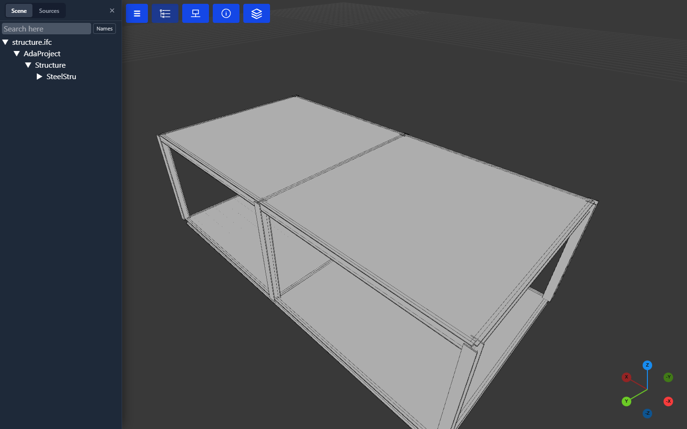
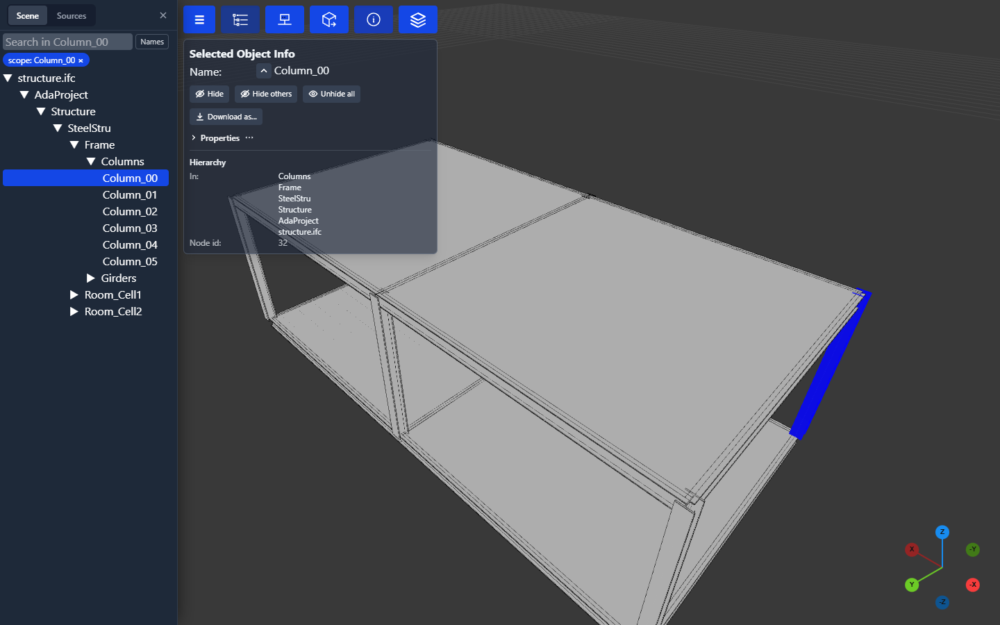
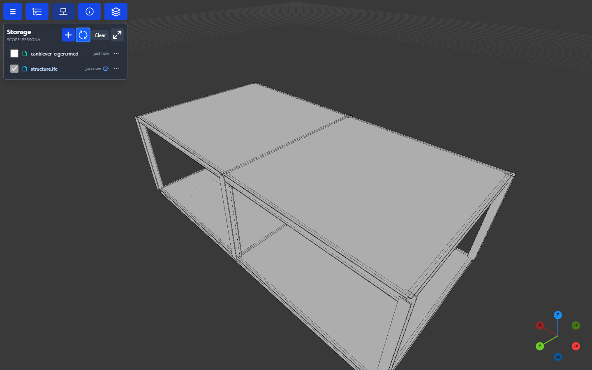
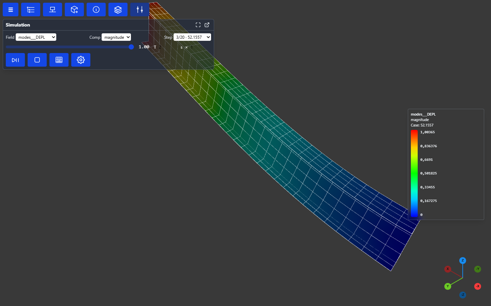
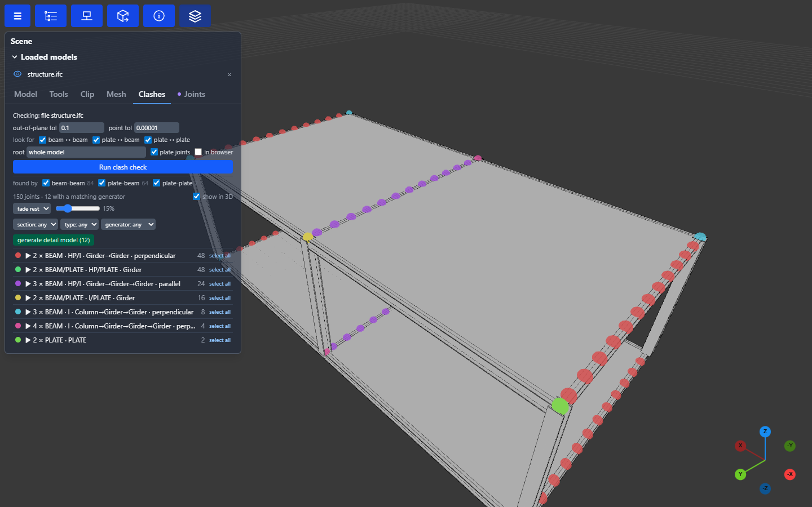

# Ada Studio

adapy is a library first. Everything on this page (reading and converting models, meshing,
clash and joint checks, baking FE results) is adapy code, and the same functions are
yours to call from a Python script, a Jupyter notebook or your own application.

Ada Studio is the web application built on top of it, with adapy as its engine. You can open
CAD, BIM and FE models in the browser, look through them, run checks on them and walk
through FE results, with no installation on the client. A server stores your files and its
workers run adapy to convert, bake and check them.

Its viewer is not limited to the hosted application. Calling `.show()` on a model, a part or
an FE result opens the same viewer from any script: in a browser tab served by a local
viewer server, or inline when the call runs in Jupyter.

The screenshots on this page are generated, not taken by hand: each one is a **user story**
in [`scripts/docs/ui_stories.py`](https://github.com/Krande/adapy/blob/main/scripts/docs/ui_stories.py)
that drives the real application (see [Regenerating the screenshots](#regenerating-the-screenshots)).

## Open a model

A model in your storage opens in the 3D view together with its object tree. Here it is an IFC
file of the [topology engine's](architecture/topology_engine.md) demo structure: columns, girders,
stiffeners and decks, organised the way the model's parts are.



## Select and inspect

Click a member in the tree or in the 3D view to select it. **Selected Object Info** shows its
name and where it sits in the hierarchy. **Properties** reads its attributes from the source
file on demand, so the model you load stays lean. From the panel you can hide the member or
everything else, and download the selection as its own file.



## Your files

**Storage** lists the files in the current scope: your personal one, a project, or the
shared scope. Tick a file to load it, and the eye icon marks what is in the scene. A source
such as an IFC, STEP or Genie XML file is converted to a viewable model the first time you
open it. **+** uploads files (or drop them on the panel), creates folders, and starts a new
procedural model, from scratch, from a template or from Excel. The **⋯** on each row holds
that file's own actions.



## FE results

Result files open in the streaming FE viewer: a Code_Aster `.rmed` here, and Sesam
`.SIN`/`.SIF`, OpenCourant `.radanim` and FE meshes the same way. Pick the **field**, the
**component** and the **step** (for an eigenvalue analysis, the mode and its frequency), scale
the deformation, or let the mode oscillate. A time history, such as an
[OpenCourant](fea/software.md#opencourant) explicit run, opens on its last frame, and the
step slider becomes a timeline that **Play** steps through at true time scale. Either kind can
be exported as an MP4 or GIF animation. Each step is fetched on its own, so a result with
hundreds of steps opens as fast as one with a single step.
[FEA → Viewer bake](architecture/fea.md#viewer-bake) explains how.



### Sets and properties

The result's named sets and model properties appear in the Scene tree after the loaded
models, in every user interface. **Sets** lists the element sets and the node sets with their
member counts. **Properties** lists each model property the bake carries, such as plate
thickness, material and beam section, with every value and how many elements have it. Which
element has which value is read from the result the first time the tree, or a picked
element, needs it. Node sets are listed for information only, because nodes carry no faces
to isolate.

Select one or more element sets or property values to **isolate** them, together. The
isolated elements keep their result colours and their deformation, the colour legend
measures only what is drawn, and the rest of the model is hidden or shown as its element
edges (**Show the rest as wireframe**). The rest cannot be shown that way when the result
has no element edges. The row menu (right-click) adds rows to the isolation, removes them,
clears it, toggles the wireframe, and hides or shows a set's elements without isolating it
(beams drawn as lines are reached only by an isolation).
Every change is one step in the undo history (Ctrl+Z).

The **Selected Object** panel lists a picked element's property values and the sets it is
in, each with an **Isolate** button. The same actions are commands in the palette (Ctrl+K),
in the Desktop UI's **View → FEA sets** menu, and work from a panel opened in a window of its
own: **Isolate FEA sets…** (by part of a set's name), **Isolate the picked element's FEA
sets**, **Clear FEA isolation** and **Show the rest as wireframe**.

## Clash and joint check

**Scene → Clashes → Run clash check** finds every place members meet: beam to beam, plate to
beam and plate to plate. It groups the joints by type (member kinds, section families, column or
girder, the angle between them) and marks them in 3D. Filter the groups, isolate one, and see
which [connection rules](architecture/platform.md#clash-and-joints-adaclash) apply. Here, 12
joints match the built-in girder-gusset rule, and **generate detail model** builds those details.



## Navigate with a 3D mouse

A 3Dconnexion SpaceMouse (or an older SpaceNavigator, SpacePilot or SpaceExplorer) can fly
the 3D view alongside the mouse. The viewer reads the device in the browser, with no driver
needed, in one of two ways. The status line in **Options → 3D mouse** says which is in use:

- **Gamepad API (no prompt).** Chrome and Edge list a SpaceMouse as a joystick-class gamepad,
  and the viewer reads its six axes from that. Nothing is asked of you and no permission is
  stored. The browser only shows a gamepad to a page once it has been moved there, so
  **push the cap once** after opening the page. The first push may zoom a little before the
  viewer sees the device, if the vendor's driver is running (it can also turn the cap into
  mouse-wheel zoom; while the cap is moving the viewer ignores the wheel and reads the cap
  itself, and an ordinary wheel is untouched). If the status reads **Device found, but no
  axes are exposed**, the browser lists the device but gives the page nothing to read; use
  the next route. Firefox does not list these devices as gamepads and Safari is untested.
- **[WebHID](https://developer.mozilla.org/en-US/docs/Web/API/WebHID_API).** Reads the device
  directly (Chrome, Edge or Opera). The first time, click **Connect SpaceMouse…** and pick the
  device in the browser's chooser; the browser remembers the choice, so later visits
  reconnect on their own, and unplugging and replugging is picked up while the page is open.
  A device opened this way is used instead of the gamepad one.

In the desktop app the device is read natively and none of this is needed.

1. Open **Options → 3D mouse** and tick **Enable 3D mouse**. It is off by default, and while it
   is off the viewer never asks the browser for the device. Until you choose, a device the
   browser already lists (a gamepad you have pushed, or a WebHID device granted before) turns
   it on by itself; switching it off in Options is remembered and stops that.
2. Push the cap once, or click **Connect SpaceMouse…** for WebHID.

The model follows the cap: push it sideways or lift it to pan, pull it toward you to zoom in,
twist or tilt it to turn the model about the orbit target. The view stays level, so a sideways
roll does nothing. The two side buttons fit the whole model and fit the selection (the same
as Shift+A and Shift+F), and **Shift+F** is also how you move the point the view turns about
onto the selection. In the same section you can set the speed, the dead zone around rest, invert
any axis, keep only the strongest axis, lock rotation or panning, and remap the buttons.

On Windows, the vendor's 3DxWare driver may hold the device, which WebHID cannot open. The
gamepad route is not affected by that, so push the cap once and it keeps working. To use
WebHID anyway, quit the driver (the 3DxService process) and connect again.

The gamepad route assumes the browser lists the axes in the device's own order and signs. This
has not been checked on every model: if the view turns the wrong way, use the **Invert**
switches in the same section.

## Marking menu and tool rail

The **marking menu** is a wheel of commands at the pointer. Hold the right mouse button still
over the 3D view for a moment and it opens: move towards a command and let go to run it. Fit
all is up, hiding is to the left with Show all above it, selection is to the right, and the
camera views are below, in a second wheel that opens as you move past **Views**. A list under
the wheel holds Undo and Redo, and, while an FE result is loaded, the set isolation. Let go
without moving and the menu stays open, so you can click a command, or choose one with the
arrow keys and Enter. **Shift+E** opens it from the keyboard, and Escape closes it. A command
that cannot run now stays in its place, greyed, and its tooltip says why. A quick right-click
still opens the object's menu, and a right-drag still pans. The menu is on in the Desktop UI.
In the classic UI, turn it on in **Options → Theme → Marking menu**. Either UI can turn it off
there or in the Desktop UI's **View → Display** menu.

The Desktop UI also has a **tool rail** down its left edge: one button per command, with its
shortcut in the tooltip. A toggle, such as Geometry edges, shows as pressed while it is on.
Right-click a tool to remove it. The button at the foot of the rail (also **Window → Customise
tool rail…**) adds any command, reorders the tools, adds separators and resets the rail to
the default. Your rail is saved with your layout.

## What else is in it

- **Assets and sources:** project trees that providers publish into a scope, with a
  **Sources** tab next to the scene tree, attributes per object, and geometry roll-ups.
- **Groups:** named selections that are saved with the scope and shared with everyone who can
  read it.
- **Procedural models:** cell-model documents compiled into structures, equipment and routed
  systems by the [topology engine](architecture/topology_engine.md), with equipment and system catalogs.
- **Plugins:** UI shells, panels and URL handlers on the frontend side, and plugin backends,
  artefact contributors and job kinds on the worker side.
- **Administration:** users, projects, storage, workers, scheduled audits of conversions,
  and the issue bot that turns failures into tracked issues.

[Viewer platform](architecture/platform.md) and [Frontend](architecture/frontend.md) describe
how it is built.

## Run it yourself

Run the API from any environment that has ada-py, and serve the built frontend from it:

```bash
pixi run -e frontend wbuild-serve                  # builds src/frontend/dist
ADA_VIEWER_STATIC_PATH=src/frontend/dist \
ADA_VIEWER_LOCAL_PATH=./viewer-data \
pixi run -e viewer-api viewer-api                  # http://localhost:8080
```

Without a job queue (`ADA_VIEWER_NATS_URL` unset) everything runs in the environment the API
was started from: file conversions (IFC, STEP, SAT, FEM, ... to GLB and the other targets), FE
result bakes, utilities and component builds, the clash check, asset builds and exports. The
heavy jobs (conversions and bakes) each run in a child process of the same interpreter, through
the same pipeline a worker runs, so a crash or an out-of-memory in a CAD reader fails that job
and not the viewer. Plugins on `ADA_WORKER_PRELOAD` or the `ada.plugins` entry points are loaded
there too, so a tool that starts the viewer from its own environment
(`python -m ada.comms.rest`) offers exactly the conversions and job kinds that environment can
run.

Every local job, of every kind, waits its turn in one queue: first in, first out, with a cap on
how many run at once, and a CPU budget the running jobs share (each job process gets its share as
its thread count, and on Linux its own CPUs). A waiting job shows `queued (n ahead)`. Cancelling it
removes it before it starts. Jobs that take a moment (reading a result deck's inventory,
detailing a few joints, a publish) get one extra lane so they never wait behind conversions. Set
the limits under Settings > Local jobs, at launch (`ada serve api --max-jobs 2 --cpu-budget 50%`,
the same flags on `ada desktop`), or with `ADA_LOCAL_JOB_PROCESSES` / `ADA_LOCAL_JOB_CPU_BUDGET`.
The budget is a core count (`4`), a fraction (`0.5`) or a percentage (`50%`). Defaults: half the
cores, at most 4 jobs, and every core. The settings are kept in the server's storage (or its
database). A launch value wins for that run and is saved. A change applies to the next job that
starts. What still needs a queue: admin audit sweeps (they measure worker pools), and job
kinds that write back to a database or chain onto another pool.

The development stack, with NATS, the API and one worker in Docker, is for working on the
queue and worker path itself:

```bash
pixi run up            # docker compose: deploy/docker-compose.dev.yml
```

### As a desktop app

`ada desktop` runs the same local viewer and opens it in a native window instead of a
browser tab (Windows first). It needs the `ada-desktop` window shell next to ada-py:

```bash
conda install -c conda-forge ada-py-desktop   # once published; until then build it from a checkout:
pixi run -e desktop-shell build-desktop       #   then ada desktop --binary src/desktop/target/release/ada-desktop.exe
ada desktop                                   # optionally: ada desktop model.ifc
```

Pop-outs and dashboard windows become native windows that remember their size and position,
and a 3D mouse works without the browser's device chooser. The viewer listens on a fixed
per-user port so layouts and settings saved in the page carry over between launches; it
stops when the last window closes. See [the CLI reference](cli.md#ada-desktop) for the
options and `src/desktop/README.md` for how the shell is built and what it lets the page do.

## Regenerating the screenshots

```bash
pixi run -e frontend wbuild-serve                   # once: the SPA the server serves
pixi run -e tests ui-stories                        # every story, into docs/screenshots/ada-studio/
pixi run -e tests ui-stories --list
pixi run -e tests ui-stories --story fea-modes      # just one; repeatable
pixi run -e tests ui-stories --theme light          # <story>-light.png
```

The script starts a throwaway Ada Studio of its own: local storage under `.pixi/ui-stories/`,
wiped on every run, with no login, no database and no job queue. It seeds a model and an FE
result, converting and baking them in-process with the same code a worker runs. A story is a
function decorated with `@story("name", "summary")`: it opens one screen in the state a user
would see it, and waits for it to settle. Add a story, then embed
`screenshots/ada-studio/<name>.png` where this page describes it.
