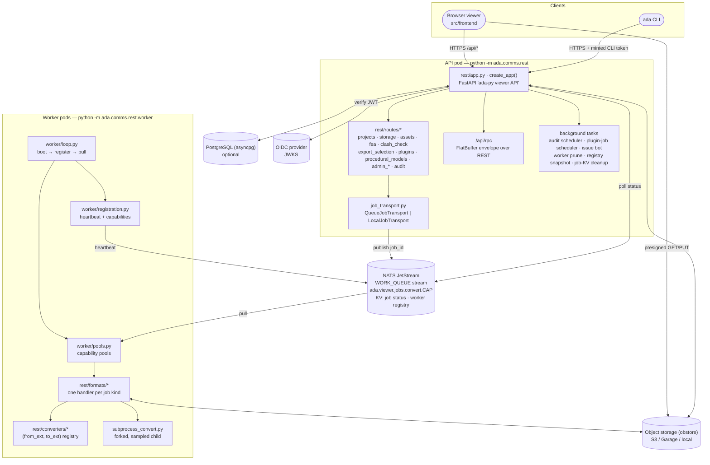
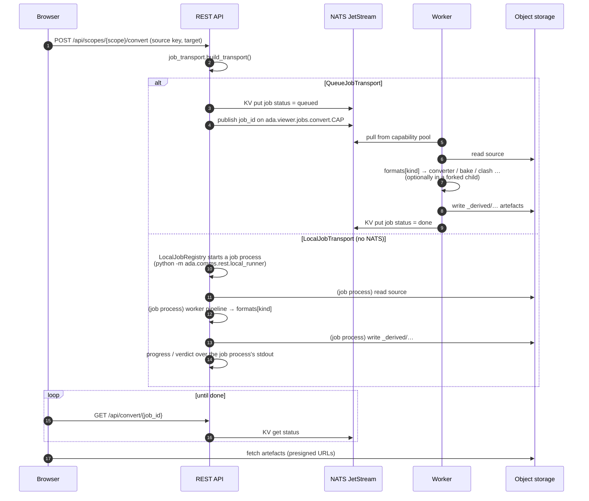
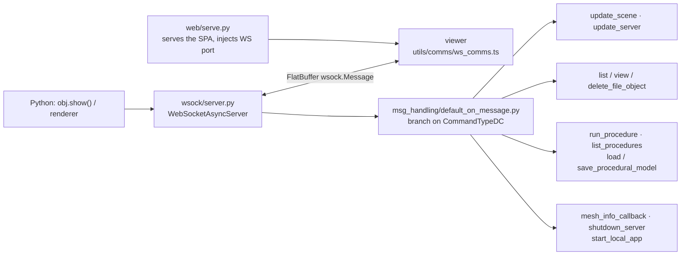
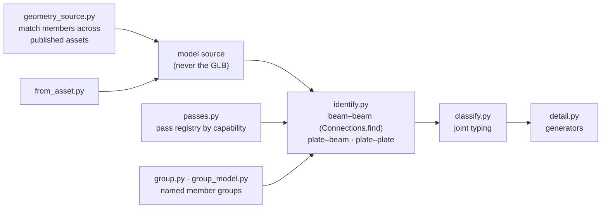
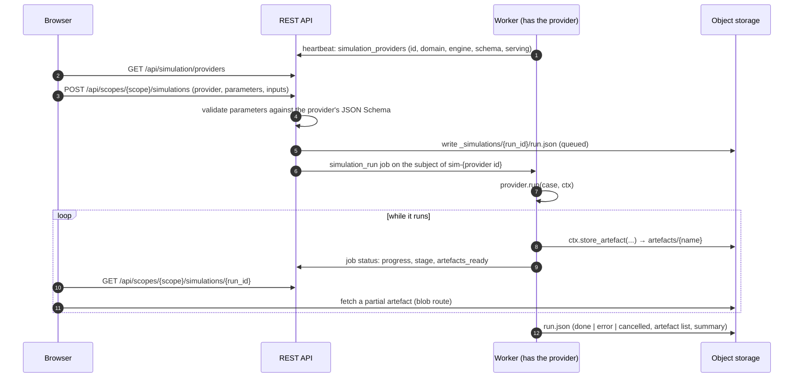

# Viewer platform

The same `ada` library runs behind two server set-ups:

- **Local:** a single-process WebSocket server (`ada.comms.wsock`) that `obj.show()` starts
  from any Python script, and that pushes scenes to the viewer as FlatBuffer messages.
- **Hosted:** a FastAPI REST service (`ada.comms.rest`) with a NATS JetStream job queue, a pool
  of workers, object storage, an optional PostgreSQL database and OIDC login.

## Deployment view



## REST API (`ada.comms.rest`)

| Concern | Where | Notes |
|---|---|---|
| App factory | `app.py` (`create_app`) | Docs at `/api/docs`. Public: `/healthz`, `/api/config`. Everything else sits under `/api` behind `auth.current_user`. `create_app` builds the services, runs the lifespan and includes the routers in order; it defines no routes beyond `/healthz`. |
| Settings | `config.py` | `Settings` with `S3Config`, `LocalConfig`, `QueueConfig`, `AuthConfig`; read from `ADA_VIEWER_*` and `DATABASE_URL`. |
| Routers | `routes/*.py` | **Projects** (`/me`, `/projects`), **storage** (files, overlays, blobs, rename/move, derived, upload-url / upload-complete / upload-progress, download-url), **source nodes**, **assets** (providers, index, tree, attributes, geometry roll-up, build, publish, staging, unpublish), **fea** (`fea/artefacts`, `fea/artefact`, `fea/manifest`, `result-meta`), **clash** (clash-check, clash-detail, passes, checkers, geometry providers, connection specs), **export_selection**, **simulations** (providers, runs, cancel), **convert** (convert, convert targets, utility, job polling `/convert/{job_id}`), **components**, **audit_local** (WASM conversion audit, view/render samples), **equipment_types / system_templates / procedural_engines**, **rpc**, **runtime_config** (`/api/config`, `/config.js`), **public_settings**, **plugins / plugin_jobs / procedural_models**, **admin** (projects, users, settings, storage, compression, workers, corpora, plugin jobs) and **audit** (runs, schedules, perf + issue bot). Shared context lives in `deps.py` (`RestContext`). |
| Auth | `auth.py`, `scope.py` | Provider-agnostic OIDC JWT verification against the discovered JWKS. Admin role from a group claim. Users are upserted lazily by `sub`. The CLI uses minted tokens. With auth disabled, a synthetic local user is used. Access is scoped to *shared*, *project* or *user*. |
| Database | `db/pool.py`, `db/migrations.py`, `migrations/*.sql` | PostgreSQL via asyncpg. Numbered SQL migrations are applied under an advisory lock. Tables: users, projects, members, audit (log, runs, schedules, parity, issue rechecks), app settings, profiling stats, corpora, worker packages, procedural models / equipment types / system templates / engines, source nodes, plugin job schedules. **Optional:** without a DB the API runs shared-only and DB-backed routes return 503, with four exceptions that fall back to hidden files in storage: user preferences (`_prefs/<user hash>/<key>.json` in the shared scope, `routes/preferences.py`; never served by the blob routes), a queue-less server's local job limits (`_prefs/_server/local_jobs.json`, `routes/local_jobs.py`; also never served), procedural models (`_procedural/<id>/model.json`, `procedural_store.py`), and the equipment-type and system-template catalogs (`_catalogs/equipment-types/<id>.json`, `_catalogs/system-templates/<id>.json`, `catalog_store.py`; the same records as the postgres rows, seeded with the defaults when a scope first uses them, archived by a flag). The last two only on a queue-less server, which also compiles, exports and imports those models itself and resolves their equipment and systems from those files. With a queue but no DB, procedural models and the catalogs stay 503. |
| Storage | `storage.py` | obstore `S3Store` (S3, Garage) or `LocalStore` (`ADA_VIEWER_STORAGE_KIND`), with gzip helpers. Sources and derived artefacts share one key space (`_derived/...`). |

## Jobs



- **Transport** (`job_transport.py`): `QueueJobTransport` (NATS) or `LocalJobTransport`
  for a set of `LOCAL_FEATURES`. The light kinds run on threads of the API (asset
  build/publish, clash check/detail, export selection, plugin jobs, simulation runs,
  procedural builds). A worker's kinds (`conversion`, FEA `bake` / `result_meta`,
  `utilities`, `component_build`) run in a child process of the same interpreter
  (`local_jobs.start_worker_job` → `local_runner.py`): the worker's own `_process_one`
  with no database, a queue that is the child's stdout pipe, and storage reopened from
  `Storage.process_spec()`. The child inherits the environment and `sys.path` and loads the
  same plugins (`plugin_registry.load_local_plugins`). Cancel terminates it, and its forked
  conversion children die with it. A crash is a job error with the tail of its output. A
  filesystem store's source is linked into the job's temp dir, not copied. Such a server
  advertises its own conversion matrix, source extensions and utilities
  (`job_transport.local_advertisement`, the computation a worker's heartbeat uses), and a
  conversion it has no converter for is a 501. Every local job, thread or process, passes
  through one FIFO queue (`local_queue.py`). It has a cap on concurrent jobs and a CPU budget
  divided over the running jobs. A job process gets its share as `OMP_NUM_THREADS` /
  `OPENBLAS_NUM_THREADS` / `MKL_NUM_THREADS` / `NUMEXPR_NUM_THREADS` / `VECLIB_MAXIMUM_THREADS` /
  `ADA_STEP_STREAM_WORKERS` / `ADA_DERIVED_GZIP_THREADS`, plus a CPU affinity on Linux when the budget is below the machine.
  A queued job reports `queued (n ahead)` and is never started if it is cancelled first. A few
  sub-second kinds take one extra lane. The limits are settings: `routes/local_jobs.py`, stored
  in `app_settings` or `_prefs/_server/local_jobs.json`, defaulting from
  `ADA_LOCAL_JOB_PROCESSES` / `ADA_LOCAL_JOB_CPU_BUDGET` and the `--max-jobs` / `--cpu-budget`
  flags. They apply to the next job. Admin audit sweeps
  (`audit_conversion`) stay queue-only. The choice is made once at start-up. A queue-less server also
  answers the procedural blueprint, template and engine catalogs from its own process, and
  lists engines registered there with origin `local` (id prefix `local:`). Its in-process
  procedural compile takes over root logging and `sys.stdout` while it runs, which is why
  it is meant for single-user (desktop) servers. The other procedural jobs on a file-stored
  model run there too (`local_jobs.start_procedural_model_job` / `start_procedural_import`),
  with the model row the route read handed in instead of read from postgres: the Excel
  export and import on the API's loop, through the engine registered in this process, a
  relocation proposal likewise, and the IFC / Genie export in a job process like a
  conversion (the model row rides in the runner's payload), since it goes through the
  native writers. An engine says whether it has an Excel format, and which handlers write
  and read it, through its registration (`register_procedural_engine_capabilities(
  supports_excel=, export_entrypoint=, import_entrypoint=)`) or its manifest row; the
  export/import routes read that, not a list of slugs.
- **Queue** (`queue.py`, `JobQueue`): a JetStream stream with WORK_QUEUE retention. The
  message body is just the job id. Status and the worker registry live in a KV bucket.
  Jobs go to capability subjects, so a worker only pulls what it can do.
- **Workers** (`rest/worker/`): `loop.py` boots, registers and pulls. `pools.py` has one pool
  per capability, fetches one job at a time and stops retrying a poison job after a limit.
  `registration.py` heartbeats the worker's capabilities (conversion matrix, utilities, clash
  passes/specs, asset concept providers, simulation providers), gated by
  `qualification.evaluate`. `routing.py` detects misrouted jobs.
- **Job kinds** (`rest/formats/__init__.py`): `convert` (fallback), `fea_artefacts`,
  `fea_meta`, `asset_build`, `asset_publish`, `component_build`, `procedural_*` (build,
  detail, relocations, xlsx import/export, model export, engine build), `equipment_bbox`,
  `plugin_job`, `clash_check`, `clash_check_asset`, `clash_check_group`, `clash_detail`,
  `clash_detail_group`, `export_selection`, `export_selection_asset`, `simulation_run`,
  `utility`, `parity`.
- **Converters** (`rest/converters/`): a `(from_ext, to_ext)` registry filled by
  `@converter`. Families: `ada_pairs` (passthrough, trimesh, ada-loadable sources),
  `ada_export` (GLB, IFC, Genie XML, GNX), `mesh_step` (STL, OBJ, STEP via OCC), `step_stream`
  (native STEP/IFC streams), `fea` (result decks), `pipelines` / `serializers` (tessellation
  engine options), `takeoff` (quantity take-off sidecar).
- **Isolation** (`subprocess_convert.run_isolated_convert`): conversions can run in a forked
  child, so a crash or memory blow-up cannot take the worker down. RSS, CPU and IO are
  sampled for the audit records.

## Desktop WebSocket server (`ada.comms.wsock`)



The messages are defined once in `src/flatbuffers/schemas/*.fbs` (root: `message.fbs`).
`src/flatbuffers/update_flatbuffers.py` runs `flatc` and the generators that write the Python
dataclasses, serialisers and deserialisers (`src/ada/comms/fb/`) and the TypeScript bindings
(`src/frontend/src/flatbuffers/`). The REST `/api/rpc` endpoint accepts the same envelope, so
the frontend can use either transport.

## Domain services

### Assets (`ada.assets`)

A tree-shaped asset store fed by **providers**: collection → subject → revision → files.

| Module | Role |
|---|---|
| `publish.py` | The provider plans, the core writes. The core stamps `published_by` and writes manifests last. |
| `index.py` | `fold_listing`: one storage prefix listing folded into the tree. |
| `rollup.py` | Geometry roll-up over the whole tree. |
| `projection.py` | The columnar `hierarchy.json` spine the viewer's tree reads. |
| `ifc/`, `builders`, `publishers`, `concepts`, `unpublish`, `keys` | The IFC provider and the build/publish/unpublish plumbing. |

`routes/assets.py` exposes the tree. Builds and publishes run as `asset_build` /
`asset_publish` jobs.

### Clash and joints (`ada.clash`)

Core identifies and types joints; generators detail them.



The REST routes in `routes/clash_check.py` enqueue `clash_*` jobs. Workers advertise the
passes and connection specs they support (`registration.py`).

Core has two checkers. `adapy` ("Member connectivity") is the diagram above: it reads the member
model and finds which members are meant to connect (beam axes meeting at a node, beam mid-spans in
a plate's padded bounding box, plates edge-on through a CAD distance). It does not measure the
solids. `convex-contact` (`convex_contact.py`, `contacts.py`, `sidecar.py`) measures the viewer GLB's
solids with adacpp -- in the browser through its wasm clash module, or on a worker through the same
C++ -- and keeps each run as a sidecar beside its model (`routes/clash_contacts.py`). The viewer's
Clashes tab runs `convex-contact` by default and falls back to `adapy`, with a note, where it cannot
run (`state/clashCheck/engine.ts`).

### Plugins (`ada.plugins`)

The Python twin of the frontend plugin registry: `register_plugin_backend`,
`discover_plugins`, `plugin_backend_specs`, `register_plugin_artefact_contributor`,
`request_worker_capabilities`, `register_preferred_pools`, plus external model providers.
Plugins are loaded from `ADA_WORKER_PRELOAD` modules and an entry-point group.
`rest/plugin_registry.py` is the only place the REST side touches the registry.

`register_preferred_pools(plugin_id, provider)` lets a plugin name the pools its worker should
fetch first while it holds something costly to set up for them (an open dataset, a warm
session). The worker fetches those pools before the others and keeps its idle pull open on the
first of them, so the next job for that pool goes to the worker that is already set up. It only
reorders the pools a worker serves, and the streak limit still makes a busy preferred pool give
the others a turn.

An idle worker does not walk its pools one blocking fetch at a time. Each round it asks the
stream which pools hold messages (one `STREAM.INFO` request with a subject filter, no lease),
fetches from those, then waits about a second on one pool. It still holds at most one leased
message. A credential without the stream-info permission falls back to polling the pools in turn.

### Simulations (`ada.simulation`)

A **simulation provider** is a worker-side object that runs simulations behind one interface, so
that a robotics simulator, a second robotics simulator and an FEA solver are three providers and
no new plumbing. Core knows no engine: it validates a request, routes the run, hands the provider
a context and keeps a record.



**The kinds of simulation.** A provider's `domain` is one of a closed set, `SIMULATION_DOMAINS`:

| Domain | Required artefact roles | Optional |
|---|---|---|
| `fea` | `result`: the solver's result file, in a format the FEA bake reads | `model`: the input deck |
| `robotics` | `model`: the animated model (GLB); `timeline`: the recorded topics over time, in the recording format its media type names (JSON, or a binary recording) | |
| `cfd` | `mesh`: the result mesh; `fields`: the field values on it over time | |

Every domain may also use the common roles `log`, `report` and `data`. A domain carries only what
is the same for every engine of that kind, so the viewer can group providers by it and open any
provider's result of that kind the same way. The roles are checked while a run is going: storing
an artefact with a role that is not the domain's fails the run, and so does finishing without a
final artefact for each required role. The `engine` (the simulator's or solver's name) is free
text and core never reads it.

**Writing a provider.** A provider has an `id` (lower-case letters, digits, `-`, `_`), a `domain`,
an `engine`, `describe()` and `run()`:

```python
from ada.simulation import ProviderDescription, SimulationResult, register_simulation_provider

class BeamSolver:
    id, domain, engine = "beam-solver", "fea", "an FEA solver"

    def describe(self):
        return ProviderDescription(
            title="Beam solver",
            version="1.0.0",
            parameters_schema={
                "type": "object",
                "properties": {"load_factor": {"type": "number", "minimum": 0, "default": 1.0}},
            },
        )

    def run(self, case, ctx):
        deck = ctx.fetch_input(case.inputs[0])          # an input file, streamed to local disk
        for step in range(10):
            ctx.raise_if_cancelled()                    # cooperative cancel
            ctx.progress(step / 10, f"increment {step}")
            ctx.log(f"increment {step} converged")
        out = ctx.workdir / "beam.rmed"                 # ... the solver wrote this
        return SimulationResult(
            artefacts=(ctx.store_artefact("beam.rmed", out, role="result"),),
            summary={"increments": 10},
        )

register_simulation_provider(BeamSolver())
```

| Piece | What it is |
|---|---|
| `SimulationCase` | `run_id`, the scope, the parameters (validated, with the schema's defaults filled in), the input keys and the kind of run. |
| `SimulationContext` | `progress(fraction, stage)`, `log(line)`, `cancelled()` / `raise_if_cancelled()`, `store_artefact(name, data_or_path, *, partial=False, role=..., media_type=...)`, `read_input(key)` / `fetch_input(key)` and a scratch `workdir`. |
| `SimulationResult` | The artefacts the provider calls final (as `store_artefact` returned them) and a small summary dict. |
| `store_artefact(..., partial=True)` | Puts the artefact in storage and on the run at once, to be replaced under the same name later: a viewer follows a run through these, as it follows the FEA bake through `artefacts_ready`. Each store raises the artefact's `revision`. |

The parameter schema is JSON Schema; the part that is checked (types, `enum`, numeric and length
limits, `required`, `additionalProperties`, `items`, `default`) is in `ada/simulation/schema.py`.

**Registering.** `register_simulation_provider` is also exported from `ada.plugins`, and a
provider's module is loaded like any plugin backend: listed in `ADA_WORKER_PRELOAD`, or reached
through an `ada.plugins` entry point. Registering asks the worker for the capability
`sim-<provider id>` through `request_worker_capabilities`, so it passes the same qualification and
`ADA_WORKER_DISABLED_CAPABILITIES` switch as any other capability. The heartbeat lists each
provider with its description and whether this worker serves it.

**Routing.** There is one job kind, `simulation_run` (`rest/formats/simulation.py`), published on
the provider's capability subject, so only a worker that registered the provider pulls it. A job
that still reaches a pool without the provider is failed at once with a reason naming the
provider (`worker/routing.py`). `POST .../simulations` refuses a provider no live worker serves
(409) and an unknown one (404) before anything is queued. Without NATS, `LocalJobTransport` runs a
provider registered in the API process in a thread; both paths call
`ada.simulation.runner.execute_run`, so a provider cannot tell which it runs under.

**What a run stores.** A run is a directory in the scope it was started in:

| Key | Content |
|---|---|
| `_simulations/{run_id}/run.json` | The run record: provider (id, domain, engine, version), kind, parameters, inputs, who started it, `created_at` / `started_at` / `finished_at`, status, stage, progress, error, job id, the artefact list and the summary. |
| `_simulations/{run_id}/artefacts/{name}` | What the provider stored. Each is listed with `name`, `key`, `media_type`, `role`, `size`, `partial` and `revision`, and fetched through the blob route. |
| `_simulations/{run_id}/cancel` | Present once a cancel was asked for. |

The record is a JSON manifest beside the artefacts, as clash runs are documents in storage: it
needs no database, it is written before the job is published, and it outlives the job status,
which the queue forgets soon after the job ends. Run ids sort by creation time, so the newest
runs come from one directory listing. Being under `_derived/`, a run cannot be written through
the blob route, and "clear temp files" removes it. Cancelling is cooperative: the marker is what
a provider's `ctx.cancelled()` finds, in whichever process runs it. A run whose job failed without
finishing the record, or whose job the server no longer knows, is ended with that reason the next
time it is read.

| Route | Does |
|---|---|
| `GET /api/simulation/providers` | The domains and the providers of the worker registry, grouped by domain (`?domain=`), each with `online` and `workers`. |
| `POST /api/scopes/{scope}/simulations` | Start a run: `{provider, parameters?, inputs?, kind?}` → `{run}`. |
| `GET /api/scopes/{scope}/simulations` | The scope's runs, newest first (`limit`, `provider`, `domain`). |
| `GET /api/scopes/{scope}/simulations/{run_id}` | One run, with the live job's progress and artefacts laid over the record. |
| `POST /api/scopes/{scope}/simulations/{run_id}/cancel` | Ask it to stop → `{run, cancelled}`. |

In the viewer, the Simulations panel (`core:simulations`) lists providers by domain, builds a
start form from the parameter schema and lists runs with their artefacts. A frontend plugin adds
what core cannot know through `simulationProviders` in the plugin registry: a parameter form
section and an "open result" handler, registered for one provider id or for a whole domain.

**A run's console.** A run has actors -- a robot, an arm, a solver stage, the mission that directs
them -- and a provider that wants its run understood, not just watched, says what each is doing
and planning as the run goes. That is the artefact with the role `activity` (a common role: any
domain may have one): an **activity feed**, JSON Lines, append-only, stored again while it grows
(`partial=True`). `ada.simulation.activity` has the format and a writer:

```
{"schema": "ada-activity/1", "actors": [{"id": "amr", "label": "Logistics robot", "color": "#4db3e6"}]}
{"t": 0.2,  "actor": "amr", "kind": "state", "text": "Driving into the cell", "data": {"goal": [-0.59, 1.92, 0.35]}}
{"t": 0.2,  "actor": "amr", "kind": "plan",  "text": "Dock beside the picker"}
{"t": 13.4, "actor": "amr", "kind": "event", "text": "Docked 23 mm off its dock", "level": "info"}
```

`t` is seconds on the run's own clock (the one its recording and its model's animation are on); a
`state` is what the actor is doing from then on, a `plan` what it intends (an empty text: none),
an `event` something that happened. The viewer reads the feed itself -- no plugin is involved --
from the moment a run's result is opened in the Simulations panel, asking for the bytes beyond
those it has while the run is going (`state/runConsoleStore.ts`). The playback transport then has
a **Console** button: a panel over the view with a row per actor (what it is doing and planning at
the playback clock's moment) and the log up to that moment, where a click on a line goes to it. It
is the same console for a replay and for a live run.

**What a run is on: subjects.** A simulation of a part with welds needs that part, and the thing
that made the part (the connection studio, a detailing engine) is not the thing that simulates it.
Core sits between them and they never name each other. A **subject** is a file in the scope of a
kind core defines (`ada.simulation.subjects.SUBJECT_KINDS`, a closed set like the domains). The one
kind so far is `weld-assembly`: a part with its welds assigned -- its members as closed triangle
meshes, and each weld's root line with the two face normals at the seam -- as JSON of schema
`ada-weld-assembly/1` (metres, +Z up, origin under the part; gzip allowed), or `ada-weld-assembly/2`
once a seam is curved or closed (a tubular joint's saddle weld runs round the brace): every weld then
carries `closed` and, per point of its line, `tangents`, `normals_a` and `normals_b`, a straight seam
being the two-point case with one tangent and the same normals throughout. The writer keeps to `/1`
while every seam is straight, so a reader of `/1` only ever refuses a curved seam rather than taking it
for a line from its first point to its last; `weld_seam(weld)` gives a weld of either as the per-point
form. A curved seam's line is the weld's sweep curve (an arc sampled every 10 mm / 10 deg), its
normals the members' surfaces at each point (from their meshes, else from the profile's direction).
A producer builds it with
`weld_assembly_from_part(part, members=None, stub_length=None, source=None)` (`members=` for a part
whose welds name members that live elsewhere, `stub_length=` to cut long beams back to the welds)
and stores it with `write_weld_assembly`; a consumer reads it with `parse_weld_assembly`, which
validates it.

* A provider says which kinds it takes: `ProviderDescription.accepts`, listed with the provider
  (`GET /simulation/providers`, and in the worker's heartbeat) as `accepts: [...]`.
* A run is started on one: `POST /scopes/{scope}/simulations` takes `subject: {kind, key}`. The kind
  must be known and accepted by the provider (400), the file must exist (404) and not be mid-upload
  (409). Its key is put first among the run's `inputs` and the record keeps `subject`; the provider
  finds it as `case.subject` (a `SubjectRef`) and reads it with `ctx.fetch_input(case.subject.key)`.
* In the viewer, a producer **offers** a subject: a plugin calls `ctx.simulations.offerSubject(
  {kind, key, label, scope?, source?})` (plugin API 1.21.0; it returns `{withdraw}`), core chrome uses
  `useSimulationSubjectStore`. The Simulations panel then shows a **Subject** picker (the newest offer
  chosen, or "(none)"), lists the providers that accept its kind first and says "does not take a
  `<kind>`" against the rest, starts the run in the subject's scope with `subject` in the body, and
  names the subject on the run's row.

The Simulations panel's **Refresh** asks for the scope's runs and the providers again: the panel
follows the runs it knows are unfinished, and a run started elsewhere since it was opened (another
tab, the API) is only found by asking.
**Replaying a run in the viewer.** What a result of a run needs on screen is not specific to one
kind of simulation, so it is in core and a plugin's `openResult` only feeds it (plugin API 1.18.0;
how the two viewports draw it is in [A viewer without three.js](threejs_free_viewport.md)):

| On `ctx` | Does |
|---|---|
| `scene.loadModel(owner, {bytes \| url, sourceName, displayName?, placement?, sourceUpAxis?})` | Loads a GLB as the scene's model on whichever viewport is on screen. `sourceName` is its identity (what `unloadModel` takes); `displayName` is what its root row in the Scene tree is called. Draco- and meshopt-compressed meshes load on both viewports, decoded by what the bundle carries. A model with node animation becomes a track of the playback clock by itself, with time zero at the animation's start; a file's several animations are shown together. |
| `scene.poseModel(owner, sourceName, names)` (1.20.0) | The nodes called `names` of the model loaded as `sourceName` with `posable: true`, for the plugin to place: `{place(matrices), found(), remove()}`. `matrices` holds sixteen numbers per name -- the node's place in the model's own coordinates, column-major as in glTF; what hangs on a node moves with it, a matrix of zeros hides it. For showing something while it is still happening: a model's own animation can only replay what was recorded. The last placement is applied again to a model loaded later under the same name, and when the viewport is switched. |
| `scene.addImage(owner, {origin, u, v, width, height, pixels, opacity?, visible?, throughModel?, nearest?, layer?})` | An image lying in the world: RGBA bytes (sRGB, straight alpha) on the rectangle from `origin` along `u` and `v`. Row 0 lies along `u` at the origin and column 0 along `v`, so with the origin at the least x and y, `u` along +x and `v` along +y, row 0 is the min-y edge and column 0 the min-x edge. Returns `{setPixels, setRect, setLook, unavailable, remove}`. `scene.imageUnavailable(width, height)` says beforehand whether the viewport on screen draws that size. |
| `scene.addLineLayer(owner, {segments? \| polyline?, color?, widthPx?, opacity?, visible?, throughModel?, layer?})` | Lines whose number changes: `{setSegments(segments, count?), setPolyline(points, count?), setLook, remove}`. |
| `scene.addPointLayer(owner, {positions?, colors?, color?, sizePx?, opacity?, visible?, throughModel?, layer?})` | Points whose number changes: `{setPoints(positions, count?, colors?), setLook, remove}`. |
| `scene.pickObjects(owner, {onPick})` (1.26.0) | The scene's clicks on objects, for a tool that asks the user to point at things: until `end()` on what it returns (or `scene.remove(owner)`), each click on an object of a loaded model is handed to `onPick({model, id, name, sourceName, point, additive})` instead of selecting it -- nothing is selected or highlighted for it, and it is no undo step. `onPick` returning `false` lets that click through. `id` is the object's draw-range id and `name` its name in the file; `point` is where it was clicked, in the model's own coordinates on either viewport (null only for an object found without a surface hit, one drawn as a line). Clicks on empty space, on a joint marker and on an analysis glyph stay core's. |
| `scene.placeBox(owner, {box, position, yawDeg?, constrain?, snap?, mode?, color?, frame?, onChange, onMode?, onEnd?})` (1.26.0; `frame` 1.29.0) | A simple box in the scene with a transform gizmo on it, for a tool that asks the user where something stands: its edges and, faintly, its faces, drawn by whichever viewport is on screen. `box` is the box in its own frame (min x, y, z, then max x, y, z); its origin is the point `position` places, the gizmo stands at and a turn goes about. `position` and the pose handed to `onChange({position, yawDeg})` are in the scene's own coordinates (the frame `ScenePick.point` and `addLineLayer` use); `yawDeg` is the turn about Z, anticlockwise seen from above. The gizmo answers the cell builder's keys by the builder's rules: G shows the move arrows (and a square that moves in X and Y at once), R the turn ring, X / Y / Z lock it to an axis -- a locked move then follows the pointer with no button held until a click or Enter puts the box down, or Escape puts it back -- and Escape or Enter otherwise end the placement (`onEnd("escape" \| "enter")`). A drag snaps to `snap.translate` (0.1) and `snap.rotateDeg` (15); `constrain: {translate: "xy", rotate: "none"}` narrows what it may do. Keys typed in a form field are the field's. Only a press on a handle is taken from the camera. Returns `{set({position?, yawDeg?, box?}), pose(), setMode("translate" \| "rotate"), end()}`: `set` moves the box from the plugin's side (an exact value, a form's number) and tells nobody; `end()` or `scene.remove(owner)` takes it away. The handles are lines drawn through the viewport interface, not the builder's three.js widget, so both viewports have them. `frame: true` frames the camera on the box when it is first drawn (once; an older core ignores it): a plugin cannot do that with `frameBox`, which takes the world's coordinates, not the scene's. |
| `scene.contactBetween(a, b, {securityMargin?, minContactArea?, lineContactThickness?}?)` (1.27.0) | Where two objects of the loaded models touch, for a tool that places something where they meet. `a` and `b` are `{sourceName, name}` as `ScenePick` names an object, plus `glb: {key, scope?}` for a model the plugin loaded itself from a stored GLB. Answers `{contact}` -- null when the two do not touch within `securityMargin` (0.01) -- or `{unavailable}` with the reason (a model whose geometry is not a stored GLB the viewer can read again, an object not in it). A contact is `{distance, normal, nearA, nearB, area, patches}`: the patches are the polygons where the two objects' convex hulls meet (`{normal, pointsA, pointsB}`, xyz after xyz on each object's surface, the normal from `a` towards `b`), in the scene's own coordinates (the frame `ScenePick.point` and `addLineLayer` use). Measured by the viewer's clash module on the stored GLBs, not on what a viewport holds, so it answers the same on either viewport; each GLB is read once and kept for the next ask. |
| `scene.highlightObjects(owner, refs, {color})` (1.29.0) | Objects of the loaded models drawn in a colour of the plugin's own, for a tool that takes the scene's clicks (`pickObjects`) and shows what it has taken: `refs` are `{model, id}` as `ScenePick` names an object, `color` is sRGB (`"#rrggbb"` or `[r, g, b]` in 0..1). They are drawn unlit, over their own colour and over the selection's, by whichever viewport is on screen, until `remove()` on what it returns (or `scene.remove(owner)`); `set(refs)` changes which objects. Not the selection, not a colour the user gave, and no undo step. Where two highlights name one object, the newer one's colour shows. An older core has no `highlightObjects`: ask for it first. |
| `scene.findObjects(names, {sourceName?}?)` (1.29.0) | The objects of the loaded models called one of `names`, read from the Scene tree, as `[{model, id, name, sourceName}]` -- what `highlightObjects` takes, plus the object's name and the source its model was loaded from. With `sourceName`, those of the model loaded from that source only. A name may match several objects (names repeat across models and within one); a row with no geometry of its own (a group) is not one. For a plugin that knows objects by name, from a file of its own, and wants to show them. An older core has no `findObjects`: ask for it first. |
| `registerPlaybackAction({id, label, title?, order?, when?, pressed?, run})` (1.26.0, on `@/viewer-core`) | A button in the playback transport, after play, the scrub bar and the run's Console: offered while `when()` holds, drawn pressed while `pressed()` holds. For showing and hiding what follows the clock (a camera's picture, a level of detail). `notifyPlaybackActionsChanged()` has the bar ask again; `unregisterPlaybackAction(id)` takes it away. A panel such a button opens is a `PanelSlot` with `toggled: true`: no top-bar button, opened and closed with `toggle(id)` / `reveal` / `hide`. |
| `storageAssetTypes: [{id, label, order?, available?, render, upload?}]` (1.26.0, on `registerPlugin`) | A kind of stored asset in the storage browser, beside the scope's files: a section under the file list headed `label`, whose body is `render(ctx, {scope})` -- the plugin's own list of what the open scope has of that kind. With `upload: {label, title?, render}` the browser's "+" menu gets an entry `label` that opens `render(ctx, {scope, close})` in a dialog: the plugin's form for adding one. `available(ctx, {scope})` (synchronous, no I/O) leaves both out where the scope has no such kind; a plugin whose answer arrives later calls `notifyPluginActivationChanged()`. Core draws the frame and never learns what the kind is. |
| `panels: [{id, region: "connection-builder", asTab?: {label, order?, contextual?, badge?}, render}]` (1.26.0, on `registerPlugin`) | A plugin's tab in the Connections panel (`core:component-controls`), after core's own tabs: Builder (the connection builder, where the scope offers connection specs), Clashes and Overlays (always), and Review (the joints review, while there are joints) -- the last three were the Scene panel's Joints group. Every panel of the region is a tab, labelled by `asTab.label` (else its `title`, else its id) and ordered by `asTab.order`. Only the tab on show is mounted, so a tab the user leaves is unmounted and must end what it was doing; the last picked tab is remembered for the page. The panel is offered wherever one of its tabs is, which with Clashes and Overlays always there is everywhere in the main window (it is not offered for a pop-out). Core's own openers of those tabs (a joints check from the asset browser, a saved group's clash check, a joint picked in 3D, `ada dev connections` at start-up) open the panel on the tab; an opener that still sets the Scene panel's old modes (`clashes`, `joints`, `jointOverlays`, `connection`) is sent there too. `getConnectionBuilderTabs(ctx)` on `@/viewer-core/plugins` lists them for a shell that draws the panel itself. |
| `panels: [{id, region: "joint-review", title?, order?, activationPredicate?, render}]` (1.29.0, on `registerPlugin`) | A plugin's section of the Connections panel's Review tab, after core's own sections (the produced joints, then the identified ones): headed by the panel's `title` (else its id), ordered by `order` (then id), and mounted in the plugin's context inside the boundary that disables the plugin when it throws. Only the active ones are shown (activation as for any region). The Review tab is there while any such section is active, whether or not core has joints to show; with none it is what it was. For what a plugin knows about the same joints that core does not. `getJointReviewSections(ctx)` on `@/viewer-core/plugins` lists them for a shell that draws the tab itself. An older core mounts the region nowhere. |
| `openConnectionsTab(tab)` (1.29.0, on `@/viewer-core/app`) | Opens the Connections panel on `tab`: one of core's tabs, or a plugin's `connection-builder` panel by its namespaced id (`<pluginId>:<id>`). The tab is picked even where the panel cannot be revealed, for when it is opened; answers whether it was revealed. For a section or a button that sends the user to a plugin's tab. An older core has no `openConnectionsTab`: ask for it first. |
| `weldSymbolSvg(type, {size?, stroke?, strokeWidth?, referenceLine?, side?})` (1.29.0, on `@/viewer-core`) | A weld type's basic symbol (ISO 2553:2019, system A) as a square SVG icon on its reference line, as markup: inline it (it is stroked in `currentColor`, so it takes the text colour, unless `stroke` names a colour) or use it as an image's `data:` URL. `type` is an `ada` `WeldType` value in any case, with or without a `WELD_TYPE_` prefix; `NONE`, an unknown type or none gives null. `size` is in pixels (24), `strokeWidth` in symbol units (0.07, the symbol is 1 wide). `side`: `"arrow"` (the default) above the line, `"other"` below it (mirrored), `"both"` for a weld on both sides (a double fillet, a double V); spot and seam sit on the line whatever the side. No identification (dashed) line is drawn. The geometry is generated from `ada.api.weld_symbols` (`scripts/codegen/gen_weld_symbols.py`) and drawn in the browser, with no request: the same markup as `WeldSymbol.to_svg`, so the server's `symbol_svg` and this one are one picture. `weldTypeName(type)` (also 1.29.0, on `@/viewer-core`) is the type's short name ("fillet", "single V butt"). An older core has neither: ask for them first (look the name up on the module), and draw the label alone without. |
| `playback` | The viewer's one clock: `addTrack({id, duration, show(t), label?})` gives `{setDuration, remove}`; `play`, `pause`, `seek`, `setSpeed`, `setLoop`, `followEnd(on)` for a recording that is still growing; `state()`, `time()`, `subscribe`. The clock's duration is its longest track's, and a shorter track (the model's animation under a longer recording) holds its last moment. |
| `layers` | The plugin's rows in the Layers panel (`core:layers`): `list`, `setVisible`, `setOpacity`, `subscribe`. A row exists while something drawn with that `layer: {id, label, group?, visible?, opacity?}` does. |

A drawn thing has two looks, and it is drawn when both say so, at the product of their opacities.
The row's look (`layer.visible`, `layer.opacity`) is the user's: the two members are only how the
row starts when the browser holds no choice for that layer id, and the switch and the slider of the
panel change it from then on. The thing's own look (the spec's `visible` and `opacity`, and
`setLook`) is the plugin's, and the panel never changes it.


Layer coordinates are the model's own, those of the loaded model's file, z-up: core places the
layers where the viewport places the model, so nothing has to be known about recentring. Arrays are
read during a call and not kept, and a handle's data is replaced in place, so a `show(t)` that fills
one buffer and hands it over every frame allocates nothing. `scene.remove(owner)` takes away
everything the owner made, tracks included. The older overlay verbs (`addLines`, `addLabels`, ...)
are unchanged: they are in the FEA model's coordinates when one is loaded.

A run's artefacts are read with `simulationsApi.fetchArtefact(scope, artefact, {start?, end?})`
(on `@/viewer-core/app`): the whole artefact, or the bytes from an offset on. An artefact that is
still being written is followed by asking for what lies beyond the bytes already read; the answer
is empty when there is nothing new, and `total` is the artefact's size at that moment.

### Audit and issue bot

Every conversion leaves an audit row: its outcome, conversion provenance and the profiler
summary parsed from the child process log (`worker/audit.py`). On a queue-less server with a
database the job process has no database, so the server records the outcome itself when the job
ends: status, error and run time (`routes/deps.py` `audit_local_job_outcome`), without the
provenance and profiler summary. Admins schedule audit runs on a
cron (`routes/admin_audit_schedules.py`, fired by the scheduler background task) and inspect
runs and performance (`admin_audit_runs.py`, `admin_audit_perf.py`). `audit_issue.py`
fingerprints failures and files or updates issues on GitHub or Forgejo (`issue_client.py`).
The `ada audit …` CLI commands fetch and reproduce runs.

## Deployment

| Artifact | Built from | Runs |
|---|---|---|
| Viewer / API image | `deploy/Dockerfile.viewer`: adacpp WASM wheel → adapy wheel → `npm run build:serve` → pixi `viewer-api-slim` env → debian-slim | `python -m ada.comms.rest` on :8080 (also serves the SPA) |
| Worker image | `deploy/Dockerfile.worker`: pixi `viewer-api` env, optional adacpp-from-source overlay | `pixi run -e viewer-api viewer-worker` |
| Docs image | `deploy/Dockerfile.docs`: pixi `docs` env → FEA report + Zensical site → nginx-unprivileged | Static site on :8080 |
| `*-fast` variants | Re-layer only changed `ada` sources on a published base | Same as above |
| Local stack | `deploy/docker-compose.dev.yml` | NATS (`-js`), api and worker, local storage, no DB |
| Cluster | `deploy/helm/adapy-viewer` | api, workers (+ extras), NATS, PostgreSQL, Garage (S3), ingress |

CI: `.forgejo/workflows/build.yaml` detects changed paths, builds the viewer, worker and
docs images (full or fast) and bumps image tags in the GitOps manifests. GitHub Actions run
the test suites, publish images to GHCR, release to PyPI, track profiling, and publish these
docs to GitHub Pages (`ci-pages.yml`).
