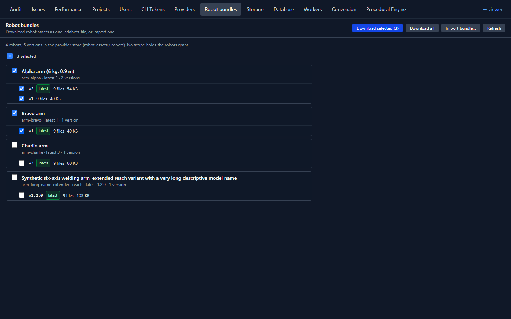
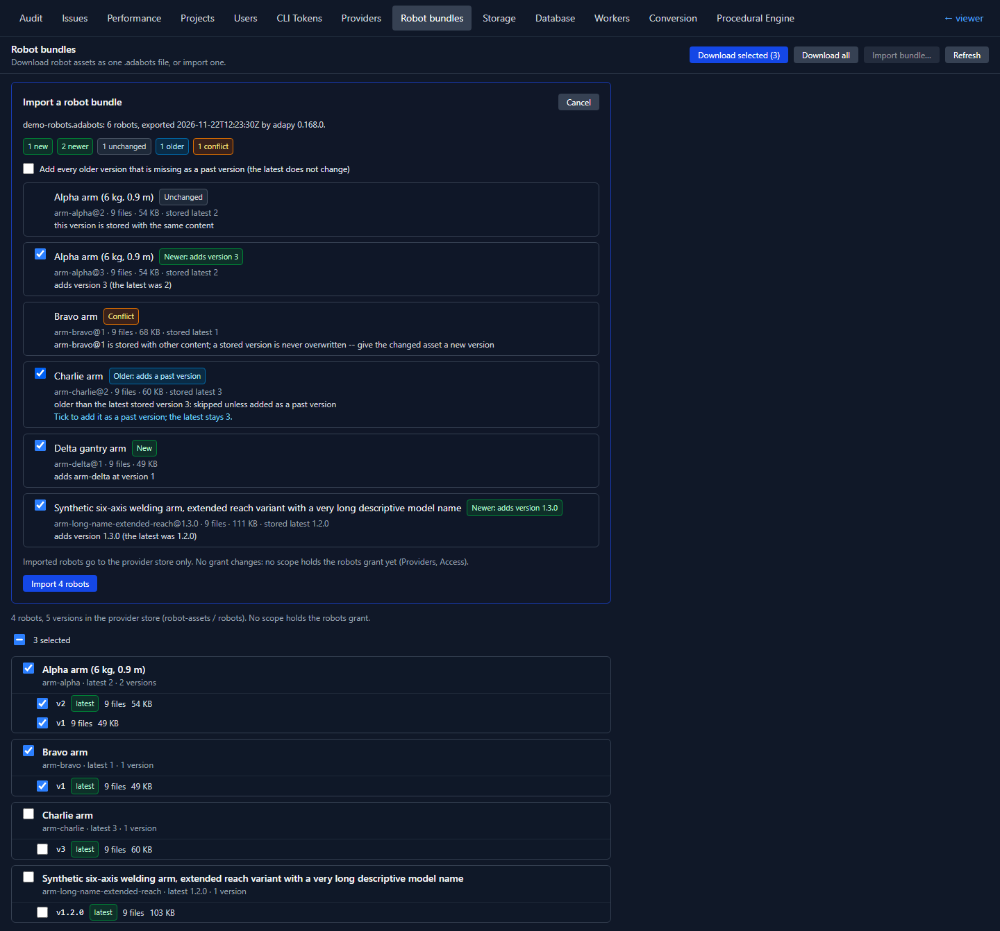
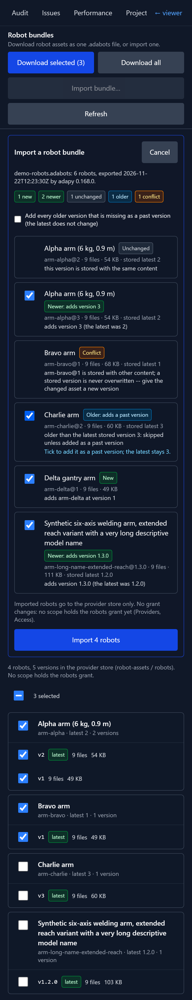

# Robot-asset bundles (`.adabots`)

Ada Studio keeps robot assets (a robot's description and its meshes) as **provider data**: once, in the
provider store, as the collection `robots` of the provider `robot-assets`. A scope reads them only through a
grant an administrator gave it (Admin, Providers, Access; see `docs/design/provider-scope-grants.md`). A
**robot bundle** carries robot assets from one Ada Studio to another, or into a backup: one robot, a selection,
or the whole catalogue, in one file.

| Where | What |
|---|---|
| `src/ada/comms/rest/robot_bundles.py` | The format, the store listing, the streaming export, the validation, the import plan and the import. |
| `src/ada/comms/rest/routes/admin_robot_assets.py` | The routes, under `/api/admin/robot-assets`. |
| `src/frontend/src/components/admin/RobotBundlesTab.tsx` | Admin, **Robot bundles**: the list, the downloads, the import. |
| `src/frontend/src/services/api/robotBundles.ts`, `src/frontend/src/assets/robotBundles.ts` | The client (`robotBundlesApi`, on the plugin surface from 1.37.0) and the shapes and rules the tab draws by. |
| `tests/comms/rest/test_robot_bundles.py`, `src/frontend/src/__tests__/admin/robotBundles.test.tsx` | The tests. |

## A robot asset in the store

```
assets/robots/<id>/<version>/robot.json          the asset's own description
assets/robots/<id>/<version>/<path>              every file it carries (meshes/coarse/base_link.stl, ...)
assets/robots/index.json                         the complete versions, for readers that cannot list the store
```

* `<id>`: lower-case letters, digits, `-` and `_` (never `__`). `<version>`: letters, digits, `.`, `_`, `-`.
* A version is complete once its `robot.json` is there; one without it is not used by anything.
* `robot.json` must say the `id` and `version` it is stored under. Wherever it names a file as
  `{"path": ..., "sha256": ...}` that file must be in the version with that sha256. Nothing else about its
  schema is core's business: the plugin that uses the assets defines it.
* Files may be gzipped at rest; every hash is of the file's own bytes.

### Versions, and which is the latest

Robot assets are versioned already: each version is a folder of its own and is never overwritten. The **latest**
version of an id is the greatest by this order (`robot_bundles.version_key`), which is also what the list shows
first:

* **revision**: a whole number (`1`, `2`, `10`), compared as a number;
* **semver**: `MAJOR.MINOR.PATCH[-pre]` (`1.10.0` > `1.9.0`, `2.0.0-rc1` < `2.0.0`);
* **natural**: anything else, compared by its runs of digits as numbers and of letters as words.

The scheme of each version is written into the bundle's manifest (`version_scheme`).

## The bundle

**Suffix: `.adabots`.** A zip by content (`unzip` opens it; it is served as `application/zip`), with a suffix of
its own so it is plain what the file is and that it goes to Admin, Robot bundles. `.ada` was considered and not
taken: it is too general a name for a file that only ever holds robot assets.

```
manifest.json
robots/<id>/<version>/robot.json
robots/<id>/<version>/<path>                     one folder per robot asset version, as in the store
```

`manifest.json`:

```jsonc
{
 "schema": "ada.robots/bundle@1",                 // a reader refuses another major (@2)
 "format_version": 1,
 "exported_at": "2026-11-22T10:00:00Z",
 "adapy_version": "0.168.0",
 "source": {"provider": "robot-assets", "collection": "robots"},
 "version_order": "revision | semver | natural; ...",
 "robots": [
  {
   "ref": "example-arm@2", "id": "example-arm", "version": "2", "version_scheme": "revision",
   "latest_in_source": true,                      // the latest version of the id where it was exported
   "name": "Example arm",                         // robot.json's label, else the id
   "path": "robots/example-arm/2/",
   "manifest_sha256": "...",                      // of robot.json
   "content_sha256": "...",                       // of the whole version: see below
   "files": [{"path": "robot.json", "sha256": "...", "bytes": 1234}, ...],
   "metadata": {"label": "...", "manufacturer": "...", "roles": [...], "levels": ["coarse"], ...}
  }
 ]
}
```

`content_sha256` is the sha256 of the lines `"<sha256>  <path>\n"` (what `sha256sum` prints) of every file
of the version, sorted by path: two versions with the same files byte for byte have the same content hash,
however they are stored.

**Deterministic.** The same assets give the same bytes: the entries are sorted (by id, version, path), carry a
fixed time (1980-01-01) and mode (0644), are deflated at level 6, and the manifest is canonical JSON (sorted keys,
one-space indent, UTF-8). The only thing that changes from one export to the next is `exported_at`; set
`SOURCE_DATE_EPOCH` on the server to fix it too. `manifest.json` is the **last** entry: the export streams each
file into the zip as it reads it, and the manifest holds every file's sha256, which is known only then. It is at
the root, and a reader finds it by name.

Files that are not of an allowed type (below) are left out of an export and listed under the robot's
`skipped_files`.

## Export

`POST /api/admin/robot-assets/export` `{"refs": ["example-arm@2", "other-arm"]}` or `{"all": true}`;
`GET /api/admin/robot-assets/export?ref=...&ref=...` or `?all=1`. A ref is `<id>@<version>`, or `<id>` for every
version of it. The answer is streamed: one stored file is read at a time and compressed into the zip as it
comes, so a large catalogue never has to fit in memory. It is `attachment; filename="<id>@<version>.adabots"`
for one robot, `robots-<yyyymmdd>-<n>.adabots` for more.

## Import

1. **Preview.** `POST /api/admin/robot-assets/import/preview` with the bundle as the raw body
   (`application/octet-stream`). The bundle is validated in full, then staged in the provider store
   (`_staging/robot-bundles/<upload_id>.adabots`, so any API replica can finish it; a staged bundle is
   removed when imported or dropped, or after a day), and the answer says per robot what an import would do.
   **Nothing is written to the robot assets.**
2. **Import.** `POST /api/admin/robot-assets/import/<upload_id>`
   `{"add_older": false, "robots": {"<ref>": {"include": true, "add_older": true}}}`. The staged bundle is
   validated and compared with the store **again** (it may have changed since the preview), and each robot is
   written on its own. `DELETE /api/admin/robot-assets/import/<upload_id>` drops it instead.

### No local copies

The API keeps no copy of a bundle, or of a file in it, on its own disk, whatever the bundle's size:

* **Preview.** The request body streams straight into the staging object as a multipart upload
  (`Storage.put_stream`: 5 MiB parts, at most two in flight). A body past `ADA_ROBOT_BUNDLE_MAX_BYTES` is refused
  with 413 before a byte is read when its `Content-Length` says so, and the moment it passes the limit otherwise;
  the multipart upload is then aborted and nothing is staged. The bundle is validated where it is staged, and a
  refused one is removed again.
* **Validation and import** read the staged object in place (`Storage.open_seekable`): a filesystem store opens
  its own file; an object store is read by range requests through a small cache of 4 MiB blocks (three of them),
  so the zip's central directory and the sequential reads of each file are a request per block.
* **Writing a robot.** Each file streams from the zip into its object: one PUT up to 5 MiB, a multipart upload
  above. zipfile checks each file's CRC as its last bytes are read, so a corrupt file fails its robot before the
  object exists.

Memory stays bounded at a few tens of MiB: the block cache (12 MiB), the parts in flight (up to 15 MiB) and a
chunk or two being read and inflated.

### What is checked before anything is written

The whole bundle is refused (400, with every problem found) when:

* it is not a zip, has no `manifest.json` at the root, or its `schema` is not `ada.robots/bundle@1`;
* an entry's path is absolute (`/x`, `C:/x`), has a `..`, `.` or empty segment, or a backslash;
* an entry is a symbolic link, is encrypted, or is in the zip twice;
* an entry is not one the manifest names, or a file the manifest names is not of an allowed type:
  `.json .stl .dae .glb .gltf .bin .obj .mtl .urdf .xacro .xml .yaml .yml .png .jpg .jpeg .webp .ktx2 .txt .md`;
* it passes a limit (environment variables, defaults in brackets): the upload `ADA_ROBOT_BUNDLE_MAX_BYTES`
  (1 GiB; a body past it is cut off with 413), all files unpacked `ADA_ROBOT_BUNDLE_MAX_TOTAL_BYTES` (4 GiB),
  one file `ADA_ROBOT_BUNDLE_MAX_FILE_BYTES` (512 MiB), entries `ADA_ROBOT_BUNDLE_MAX_FILES` (10 000), robots
  `ADA_ROBOT_BUNDLE_MAX_ROBOTS` (1 000); and a file over 1 MiB that unpacks to more than 1 000 times its packed
  size.

A robot is **invalid** (shown, never written; the others go on) when one of its files is not the size or the
sha256 the manifest says (read, never trusted from the zip header), its `content_sha256` is not its files' hash,
it has no `robot.json`, its `robot.json` says another id or version, or names a file with another sha256.

### What an import does with each robot

A bundle robot is matched to the stored assets by its **asset id** (the folder name, and `robot.json`'s `id`).
The id is chosen by whoever built the asset and travels with it -- no install makes up its own -- so it is the
same key in every Ada Studio, and no other key (a name, a label) is used to match: two robots with the same label
are two robots. Where the same `robot.json` is stored under another ref the preview says so (`duplicate_of`),
and imports it as what it says it is.

Each robot is held against the versions of its id stored **before** the import:

| Status | When | The import |
|---|---|---|
| `new` | no version of the id is stored | adds it; it is the latest |
| `unchanged` | that version is stored with the same content hash | nothing |
| `newer` | newer than the latest stored version | adds it as a new version, which becomes the latest; the earlier versions stay |
| `older` | older than the latest stored version, and not stored | nothing ("older, skipped"); with `add_older` (for the bundle or that robot) it is added as a past version, and the latest stays what it was |
| `conflict` | that version is stored with other content | nothing, ever: a stored version is never overwritten. Give the changed asset a new version. |
| `invalid` | its files do not hold up (above) | nothing |

A robot can also be left out (`include: false`). Exporting a store and importing the bundle into the same store
gives `unchanged` for every robot.

**Atomic per robot.** A version's files are written first and its `robot.json` last; a version without
`robot.json` is not used, so a reader sees all of it or none. If any write fails, what was written of that robot
is deleted again, the robot is reported `failed`, and the next robot goes on. An incomplete leftover of the same
version (from an upload cut short) is replaced. After an import that wrote anything, `assets/robots/index.json`
is rewritten from what is stored (one row per complete version: ref, id, version, label, `manifest_sha256`,
levels, roles, payload, reach and the file sizes), keeping the index's `schema`.

The answer is one row per robot of the bundle: `added`, `added-older`, `skipped`, `conflict` or `failed`, with a
sentence saying why.

### Grants, scopes and ownership

* **Who.** Every route is under `/api/admin` and so is an administrator's; a member is refused (403). The robot
  assets are provider data, which only an administrator writes.
* **Where an import writes.** The provider store only (`providers`), under `assets/robots/`, whatever scope the
  administrator had open. Never into another scope, never a copy per scope.
* **Grants are not in a bundle and an import changes none.** A grant names scopes of one deployment (projects by
  their id, users by theirs) that mean nothing in another, so carrying them would grant the wrong thing or
  nothing. The scopes that already hold the `robots` grant of `robot-assets` (or the provider-wide grant) read the
  imported versions at once (within the 30 s the store's "it holds the dataset" answer is cached; an import clears
  it); a scope without it reads none of them until an administrator ticks `robots` for it in Providers, Access.
  The list and the preview say which scopes hold the grant.
* **Ownership.** The provider store belongs to no user or project, so an imported asset has no owner to keep:
  who imported what, and when, is in the audit log (`robot-bundle-import`, `robot-bundle-export`).

## The Admin panel

**Admin, Robot bundles** (`/admin#robots`):

* The stored robots, one card per id (its name, id, latest version) with its versions under it, newest first.
  A checkbox per version, one per robot (all its versions), and "Select all".
* **Download selected (n)** and **Download all**: the bundle is fetched as the administrator and saved.
* **Import bundle…**: a drop zone that is also the file picker (a tap opens it on a phone), the upload's
  progress, then the preview: per robot its status (New / Unchanged / Newer: adds version X / Older: skipped /
  Conflict / Invalid), what it would do and why, a box to leave a new one out or to add an older one as a past
  version, "add every older version" for the bundle, the scopes that will read the result, and **Import n
  robots**. Then the results, robot by robot.







On a phone (390 x 844 and up) it is one column with 16 px gutters, every control at least 44 px tall, buttons in
two columns, long names wrapping, and nothing that scrolls sideways. The file input has no `accept` filter: iOS
greys out a file whose type it does not know, which a `.adabots` file is; the name is checked once picked, and the
server checks everything.

## Not (yet) covered

* A bundle is uploaded through the API (up to `ADA_ROBOT_BUNDLE_MAX_BYTES`, and whatever the ingress in front of
  it allows), streamed into staging; there is no presigned upload straight from the browser to staging.
* A download is kept by the browser as a Blob before it is saved: the server streams, the browser buffers.
* Removing a version is not part of this.
