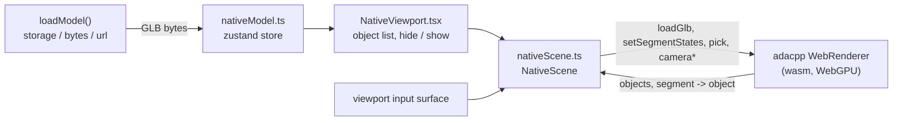
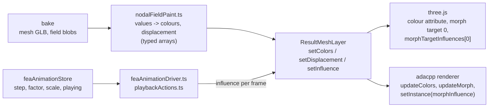
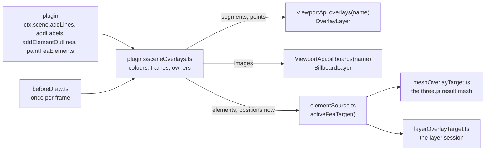
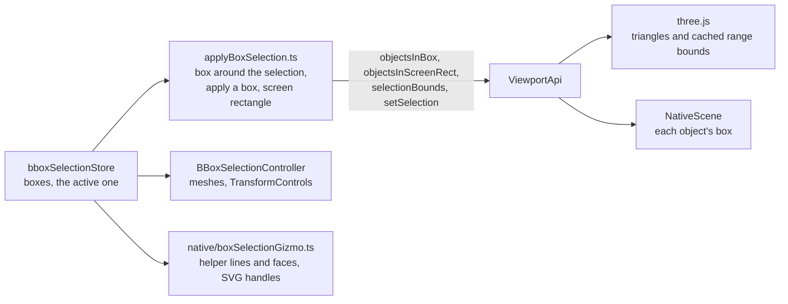
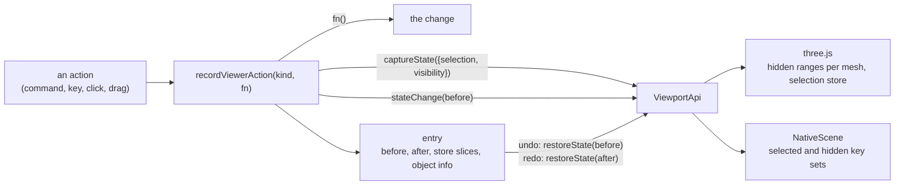
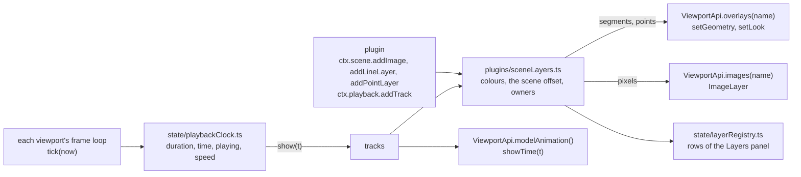

# A viewer without three.js

The browser viewer draws through one of three paths, chosen in Options > Performance > Renderer or
with `?renderer=` in the URL:

| Choice | `?renderer=` | What draws | What three.js still does |
|---|---|---|---|
| three.js (WebGL) | `three` | `THREE.WebGLRenderer` | everything |
| adacpp WebGPU | `adacpp` | adacpp's WebGPU renderer (`adacpp_render.wasm`) | scene graph, loading, controls; optionally labels, point picking and capture (see below) |
| adacpp WebGPU, no three.js | `native` | adacpp's WebGPU renderer | nothing in the viewport's own chunk |

This page is about the third. It records why it is a separate viewport, what the first slice
contains, and what each later slice has to settle. The code is `src/frontend/src/viewport/native`.

## Why it is a second viewport, not a switch

About 160 non-test modules under `src/frontend/src` import three.js, and only about two dozen of
them touch the `WebGLRenderer`. The rest use three.js as the **data model**: `CustomBatchedMesh`
holds a model's merged buffers and draw ranges, stores hold `THREE.Object3D`s and `THREE.Plane`s,
and the scene helpers add meshes, lines and sprites to one `THREE.Scene`. The adacpp WebGPU path
keeps all of that and mirrors the scene into the renderer each frame (`viewport/adacpp/sceneSync.ts`).

So there are two different questions:

- **Can the picture be made without WebGL?** Yes, with the existing data model. That is the
  `adacpp` choice with its hand-over switches: labels, point picking and capture move to adacpp one
  at a time, and "WebGPU only" constructs no `WebGLRenderer` at all (`viewport/nullRenderer.ts`).
  three.js is still loaded and still owns the scene.
- **Can the viewer run without three.js?** Only with another data model. No set of switches gets
  there, because every feature is written against `THREE.Scene`. That is what `native` explores.

## The first slice

`NativeViewport` is mounted by `CanvasWrapper` **instead of** `ThreeCanvas` and the scene
controllers. It is loaded lazily, and its chunk imports no three.js.

| Part | How the slice does it |
|---|---|
| Loading | `loadModel` resolves the source as it always does, then hands the GLB **bytes** to the store instead of calling `GLTFLoader`. `NativeScene.load` passes them to the renderer's own reader (`WebRendererApi.loadGlb`), the one the offscreen posters and the WebGPU embed use. |
| Scene model | None on the JavaScript side. The reader merges primitives per topology and material and keeps each adapy draw range as a **segment**, and `loadGlb` returns the model's objects (id, name, parent, bounds, triangle count) and which object each segment draws. |
| Several models | The scene holds any number of models. An object is known by one key made of its model's key and its id (`objectKey`), so two models may use the same ids. A load asked for as an addition joins the others, leaves the camera where it is and adds a root to the Scene tree; unloading a source removes that model's geometry (`ViewportApi.unloadSource`). |
| Per-object state | Two sets, selected and hidden, written to the renderer as segment state (`setSegmentStates`). Hidden wins over selected. |
| Camera and input | The renderer's own camera (`setCameraControlled`). The viewport maps input from the viewport's input surface (`viewport/input.ts`, the same element the three.js controls use) to semantic operations: orbit, pan, zoom, zoom towards the cursor, fit to a box, look from a direction. Fit and the named views move there over a short time, and a drag glides to a stop when the camera settings say so. |
| Picking | `WebRendererApi.pick` at the pointer, mapped through the reader's segment table to an object id. |
| Tree and object info | The viewer's own Scene tree and object info. The viewport announces the model it loaded and what a click picked (`onModelLoaded`, `onViewportPick`); the panels' side (`sceneHelpers/viewportPanelBridge.ts`) builds the tree from the GLB's scene extras and names the picked object. A tree row and a viewport object are the same thing by `ObjectRef`: the model's key and the object's id in it. |
| FEA results | Drawn through **result layers** (see below): the mesh from the bake's GLB as typed arrays, a nodal field as per-vertex colours, the deformed shape as a morph whose influence is the deformation scale. The Simulation panel, the result commands and the colour legend are the viewer's own. |
| Screenshots and the orientation gizmo | `saveScreenshot` draws the view at the screenshot's size and saves the canvas' picture. The world's axes in the corner are an SVG drawn from the camera's pose (`NativeOrientationGizmo.tsx`); an axis end looks at the model from there. |
| Failure | If WebGPU or the module cannot start, or the device is lost, the state becomes `failed` with the reason, `CanvasWrapper` mounts the three.js viewport, and the model that was handed over is loaded there. The Performance panel shows the reason. |

What the main viewer does beyond this is listed in the viewport itself under "Not available in
this mode", so nothing looks broken by omission.

React reads the selection through `viewport/api/useViewportSelection.ts` (its count, the selected
objects, a token that changes with it), so a panel written against it follows whichever viewport is
on screen.

### Keeping the chunk free of three.js

`src/__tests__/viewport/nativeViewportImports.test.ts` walks the import graph from
`NativeViewport.tsx` (static imports, re-exports and `import()`; type-only imports are erased by
the build and do not count) and fails on the first import of `three`, printing the chain that
leads to it. Shared code the chunk needs was moved out of modules that import three.js rather than
duplicated: starting the renderer lives in `viewport/adacpp/rendererModule.ts`, used by both WebGPU
viewports.

The end-to-end test `tests/full/frontend/test_render_backends.py` runs the slice in Chromium
(load, pick, select, hide, show all) and asserts that the page created no WebGL context.

## FEA results on both viewports

A shown result is three things, and only the last differs between the viewports:

| Part | Where | What it is |
|---|---|---|
| The numbers | `utils/scene/fea/nodalFieldPaint.ts` | One step of a nodal field as two typed arrays: RGB per node from the colour map and the range (the field's, the measured one, pinned ends, bands), and the un-scaled displacement per node. One pass, no allocation. |
| What a viewport draws | `viewport/api/resultLayer.ts` | `ResultMeshLayer`: colours, displacement, and the **influence** (the drawn shape is `base + influence * displacement`), and a plain colour for while the painted ones are not shown. `ViewportApi.results.createResultMesh` makes one from positions and indices. |
| three.js | `utils/scene/fea/threeResultLayer.ts` | The layer over a mesh: the streaming loader's result mesh is wrapped (`threeResultLayer`), so its selection, overlays and beam sections are as before. |
| adacpp renderer | `viewport/native/nativeResultLayer.ts` | One geometry with colours and a morph, one instance. Colours and displacement are written into buffers kept on the module heap, so a step allocates nothing. |
| Playing | `feaAnimationDriver.ts`, `playbackActions.ts`, `resultInfluence.ts` | The oscillator and the transport write one number per frame to the layer in `feaAnimationStore.resultLayer`. No vertex data moves while a mode shape plays. |
| Controls and legend | `utils/scene/fea/streaming/resultStores.ts` | A painted result is registered the same way from either loader: the session, the step count, the derived deformation scale, the legend's range. |
| The loader without a scene | `utils/scene/fea/streaming/layerSession.ts` | Reads the mesh GLB as typed arrays (`utils/glb/glbMesh.ts`), draws faces and element edges as layers, paints a nodal or an element field, registers the step callback. `load_fea_streaming` hands a load to it while the three.js-free viewport is on screen. |
| Element fields | `utils/scene/fea/elemFieldPaint.ts` | One step of an element (integration point) field as typed arrays: a colour per render vertex, the displacement per node, the result-point markers, the coloured lines of line elements, and each element's painted value. An element's colour is its own, so the mesh it is painted on is element-local (a vertex per triangle corner). `applyElemField.ts` writes the same output to the three.js mesh. |
| Elements as objects | `viewport/api/resultLayer.ts` (`ResultMeshObjects`), `viewport/native/resultObjects.ts` | A result mesh says which objects it is made of: a model key, its object ids, and the part of the index list each draws. The three.js-free scene makes them the renderer's segments and registers the model beside the loaded ones, so pick, select, hide, show, isolate and fit go through `ViewportApi` as for any model, and `onModelLoaded` carries the hierarchy the Scene tree lists. The selection is a per-segment colour, so the other elements keep their result colours. |
| Beam sections | `utils/scene/fea/streaming/layerBeamSolids.ts` | The beam solids of a bake as typed arrays, from the compact artefact (expanded by the compute capability) or the mesh GLB with its sidecars. Drawn as one more layer when asked for; each section is the object its element is. |
| What a layer can be | `viewport/api/resultLayer.ts` | Triangles, lines or points, with a width or diameter in pixels and an opacity: result points are a layer of points, the coloured lines of line elements and the undeformed outline are layers of lines. `streaming/layerGroup.ts` holds a result's layers as one for the controls and the playback driver. |
| Number labels | `utils/scene/fea/labelPlacement.ts`, `layout/NumberLabels.tsx` | What is worth a label and where it goes, from a `LabelSource` (elements, their vertices, where each vertex is now) and a projector. `ViewportApi.projectToScreen` projects a batch of world points to CSS pixels and depth, and `onCameraChange` says when to do it again; the three.js mesh (`numberLabels.ts`) and the layer session are the two sources. |

| Edges of beam sections | `utils/scene/fea/beamSolidFeatureEdges.ts`, `streaming/layerSession.ts` | The corners of each section and the outline of each end, worked out from the beam solids' arrays (in a worker where one can be started) and drawn as a layer of lines over the sections' own vertices: they take the sections' displacement, and a hidden beam's are left out. "Solid edges" shows and hides them. |
| Sets and properties | `utils/scene/fea/streaming/manifestStores.ts`, `utils/scene/fea/layerIsolation.ts` | The manifest's sets, dummy-mass beams and FEA input concepts go into the stores the three.js loader fills, so the Scene tree lists "Sets" and "Properties" for either. A set is a list of element ids, and the elements are the viewport's objects: isolating, hiding and showing a set go through `ViewportApi` (`isolate`, `hide`, `show` take any iterable of refs, read once, so a set of thousands is one reused ref). "Show the rest as wireframe" keeps the edges of the hidden elements, and of the hidden beam sections, in the edge colour they have, as on the three.js viewport. The scene actions pick this module or the three.js one (`feaIsolation.ts`) by how the result is drawn. |
| Beams drawn as lines | `utils/scene/fea/streaming/layerLines.ts` | The coloured lines of line elements are objects of the viewport too: each line is a segment of its layer and the object its element is, so hiding, showing, isolating and selecting an element reach a beam that only a line draws, and an isolation in force is applied again when a field first colours them. The lines of the dummy-mass beams are never drawn, as on the three.js viewport: such a line runs to the mass, where the element is not. |
| Recorded frames | `utils/scene/fea/streaming/layerFrames.ts`, `framesKey.ts` | A frame a play has painted is kept as plain data (the displacement per node, the colours of the faces and of the beam sections as bytes, the colours and displacement of the result points and of the coloured lines) under the key the three.js recorder uses, and written to the layers on the next pass without reading or painting the step. Where the points and lines are is kept once: a frame that has them elsewhere (a value that is not a number leaves its point out) is painted again instead. Out of the step cache's budget, as there. |
| A plugin's view of the result | `utils/scene/fea/deformationGate.ts`, `unpaintedColor.ts` | Who holds the result undeformed (`setFeaDeformationShown`) and who asked for which colour of the unpainted model (`setFeaUnpaintedColor`) is kept once, without three.js. The gate has the last word before each frame of either viewport: on the three.js one it writes the meshes' morph influence (`threeDeformationGate.ts`), on a result drawn through layers the influence of every layer, 0 while held and the user's own when let go. The colour goes to the base material of the three.js meshes (`threeUnpaintedColor.ts`), or to the plain colour of the face and beam-section layers, which shows while nothing paints them and is given back when no one asks. |

| A click on a line | `utils/scene/fea/streaming/layerLinePick.ts`, `viewport/api/objectAt.ts` | The renderer picks triangles, so a beam drawn only as a line is found on the screen: the lines are plain data, projected through the viewport, and the one within a few pixels of the cursor is the click's when it is in front of the surface the renderer's own pick found (with the allowance the three.js viewport gives a stiffener lying on its plate). The viewport asks whoever registered a finder after its own pick. |
| Fading the grid | `utils/scene/fea/edgeFade.ts` | "Fade edges when zoomed out": how opaque the element grid is drawn, from how far apart its edges are on screen where the user is looking. The three.js viewport sets its line material's opacity before each frame; the layer session sets the opacity of its grid layer (`ResultMeshLayer.setOpacity`), and of the beam sections' edges with it, when the camera or the setting changes. |

Both viewports paint with the same kernels, and the layer session does what the three.js
viewport's own loader does.

The "FEM groups" picker of the Scene panel is on both: a set's members are element ids, which are
the result's objects, and `utils/groups/selectGroup.ts` selects them through
`ViewportApi.setSelection` (one reused ref for the whole set). For a GLB the groups come from its
`ADA_EXT_data` extension, which the three.js-free viewport announces as JSON text with the model
(`utils/groups/extensionGroups.ts` lists them), and the members are object names the model's
hierarchy resolves to ids.

## Overlays on both viewports

What a feature draws over the model without it being part of the model is plain data handed to
the viewport on screen, by handle:

| Part | Where | What it is |
|---|---|---|
| Lines and points | `viewport/api/overlayLayer.ts` | `OverlayLayer`: line segments or points in the world (or in a frame given as a matrix), one colour or a colour each, a width or a size in pixels, dashes, over the model or depth-tested, cut by the section planes or not. `addLines` / `addPoints` return a handle; `setPositions` moves what it draws. |
| three.js | `viewport/api/threeOverlays.ts` | Wide lines (`LineSegments2`) and points in the scene, as plugin lines were always drawn; the adacpp WebGPU viewport mirrors them. |
| adacpp renderer | `viewport/native/nativeOverlays.ts` | A geometry of the renderer per overlay, through the scene's result layers with the look of an annotation (`ResultMeshData.overlay`: unlit, never picked, over the model or just in front of the faces it lies on). A move is written as the geometry's morph, and what is drawn is made again after a load emptied the scene. |
| Labels | `viewport/api/billboards.ts` | A plugin's labels are billboards of constant size on screen, cut by the section planes at their anchor (`clipped`), their image sampled without mipmaps (`crisp`). |
| The result under them | `utils/scene/fea/elementSource.ts` | `activeFeaTarget()`: the FEA result on screen as `ElementGeometry` (each element's range of the index list, a vertex where it is drawn now, a version that changes when that may have, where the mesh stands), and the element-level verbs only the result can do (paint, hide, isolate). Two results register themselves: the three.js loader's mesh and the layer session. |
| Following the result | `viewport/api/beforeDraw.ts` | Each viewport's frame loop runs the listeners before it draws. An outline or a pinned label compares the geometry's version and writes new positions only when it changed. |
| Painted elements | `meshOverlayTarget.ts`, `streaming/layerOverlayTarget.ts` | On the three.js mesh, a copy of its triangles with the mesh's morph and its influences (as before). On the layer session, the painted elements' triangles as one more result layer, a vertex per corner, pinned to the session so each step's displacement and the deformation scale reach it. |

The plugin-facing verbs are unchanged. What differs between the viewports: on the three.js-free
one, lines drawn over the model are not ordered among themselves by when they were added, dashes
are measured once (not again after the line moved), and hiding elements through a plugin clears
the selection as any hide does there. An overlay is drawn by the viewport that was on screen when
it was added; it is not carried over when the other viewport takes its place.

## What a model says beside its geometry

A model's `ADA_EXT_data` extension carries what is not geometry: the concepts of an analysis model
(masses, supports, constraints, load scenarios, placed equipment) and what links a design model to
the analysis models made from it. Both are read and shown without a scene object.

| Part | Where | What it is |
|---|---|---|
| The extension | `state/sourceExtensions.ts`, `sceneHelpers/viewportPanelBridge.ts` | The three.js loader keeps a model's extension on its scene group. The three.js-free viewport announces the text with the model, and it is parsed once and kept by source name. A streamed result has no extension: its manifest fills the same stores. |
| The glyphs | `utils/fem/conceptGlyphs.ts` | Plain data from the concepts that are switched on: triangles (spheres, diamonds, boxes, arrow heads) with a colour per vertex and line segments, grouped by how they are drawn (over the model, or behind what is in front of them), and a table of what a click can hit. |
| Drawing them | `components/viewer/FemConceptsController.tsx`, `viewport/api/overlayLayer.ts` | One controller follows the viewport on screen and draws the glyphs as its overlay: `addMesh` (unlit triangles) beside the lines and points an overlay already had. three.js draws a mesh, the adacpp renderer a result layer in the look of an annotation. |
| Clicking them | `utils/fem/conceptPicking.ts` | A click is resolved on the screen against the pick table, through `ViewportApi.projectToScreen`: a ball by its projected radius, a line by its distance in pixels, a box by the faces it shows, with the depth under the cursor. Each viewport asks before it picks an object (the three.js click handler; `NativeScene.clickFirst`). A point glyph wins outright; an equipment box only when it is nearer than the surface under the cursor. |
| The link | `state/lineageStore.ts`, `utils/lineage/registerLineageFromExtension.ts`, `utils/glb/glbBufferView.ts` | Which design object an element was meshed from, and back, keyed by the design's id. Registered from the extension by either viewport; the ids of a large group are in a buffer view, which the three.js loader's parser or a small GLB reader hands over. A result drawn through result layers registers from its manifest. |
| Following it | `utils/scene/crossModelSelect.ts` | "Select in CAD" and "Select FEA elements" find the other model by its root row of the Scene tree, resolve the names against that model's hierarchy and make the objects the viewport's selection. The three.js viewport keeps its own path over its scene objects. |

A click names the file of the model that was picked (`utils/tree_view/modelSource.ts`, by the
model's root row of the Scene tree), on either viewport, so a link is offered for an object of any
loaded model and not only of the one loaded last.

## Box selection on both viewports

A selection box is plain data, and so are its rules; only "which objects are in it" is the
viewport's to answer.

| Part | Where | What it is |
|---|---|---|
| The boxes | `state/bboxSelectionStore.ts` | Bounds, mode ("partially within", "fully within"), colour, opacity, visibility, and which box is the active one. No three.js. A change to the boxes records itself as an undo step, as a change to the section planes does. |
| The rules | `utils/bboxSelection/boxMath.ts`, `screenRect.ts`, `boxHandles.ts` | A box against a box or a triangle; a rectangle on the screen against a box's picture (a window takes what is wholly inside, a crossing what touches); a box's edges, faces and handles, and the pointer's place along a handle's axis. Plain numbers, unit-tested. |
| What a viewport answers | `viewport/api/boxSelection.ts` | `objectsInBox(box, mode)`, `objectsInScreenRect(rect, mode)` and `selectionBounds()`, all members of `ViewportApi`. The first two return an `ObjectSet`: iterable as object refs (one ref reused), and taken back by the same viewport's `setSelection` without a lookup per object. Hidden objects and ones a section plane cuts away whole are never in an answer. |
| Applying | `utils/bboxSelection/applyBoxSelection.ts` | A box around the selection, the selection a box makes, the selection a screen rectangle adds, and "the active box's selection follows its bounds and mode". Used by the commands (`Box around selection`, `Selection box takes only what is fully within`, `Reselect with selection box`, `Remove selection boxes`), the Scene panel, the tree's menu and both viewports' controllers. |
| three.js | `utils/bboxSelection/threeBoxSelection.ts`, `BBoxSelectionController.tsx` | As before the interface: an object on a box's boundary is decided on its triangles, one that straddles a screen rectangle on its vertices or triangles. Boxes are meshes, the handles spheres, the move gizmo `TransformControls`. |
| adacpp renderer | `viewport/native/nativeBoxSelection.ts`, `boxSelectionGizmo.ts` | Decided on each object's box from the GLB reader. A box's edges are helper lines and its faces see-through triangles of the renderer; the face handles and the move arrows are an SVG placed from the camera after each frame, and a press is hit-tested against them before the camera sees it. Shift and a drag draws the rectangle; a right-click on a box opens its menu. |

Where the three.js-free viewport's answer is coarser, because it keeps no triangles on the
JavaScript side:

- **Partially within a box.** An object is taken when its box touches the selection box. The
  three.js viewport looks at the triangles of an object on the boundary, so it leaves out a slanted
  or L-shaped object whose box reaches in while the object itself does not. "Fully within" is the
  same on both: an object is inside exactly when its box is.
- **A rectangle on the screen.** A window takes an object when the picture of its box is wholly
  inside, so it can miss a slanted object that is itself inside while its box's corner sticks out;
  a crossing takes an object when the picture of its box touches, so it can take one that only its
  box's corner reaches.
- **An object with children that draws something itself.** The reader reports one box per object,
  of the object and everything below it, so such an object is judged by the larger box.

Two more things about boxes are the same on both viewports:

- **Kept across reloads.** `utils/bboxSelection/boxPersistence.ts` keeps the boxes of a scope in the
  browser, bound by whichever viewport draws them. A box is in world coordinates, and the two
  viewports place a model differently: the three.js one recentres what it loads, the three.js-free
  one draws a model where its file puts it. The offset in use is published as plain numbers
  (`state/sceneFrameStore.ts`: mirrored from the three.js model state, zero on the three.js-free
  viewport) and stored with the boxes, so a box moves by the difference and stays over the same
  object, on a reload and from one viewport to the other.
- **"Request from source".** What a box holds is asked of the viewport on screen (`objectsInBox`),
  read as object refs and folded to whole levels of the Scene tree (`captureObjects` in
  `utils/groups/groupScene.ts`); where each loaded model's own frame is in the world comes from the
  viewport too (`sourceOrigin`). Finding candidates, the plan and the request are then the same code
  for both. Putting what was requested into the scene (`boxSiteLoad.ts`) loads whole sites and hides
  the rest by tree row. Holding a model invisible while it loads is the three.js loader's, so on the
  three.js-free viewport a site would be drawn whole until the rest is hidden; that last step has
  not been exercised there against a live source.

## Undo and redo on both viewports

One history (`state/viewerHistoryStore.ts`), filled by `recordViewerAction` in
`utils/scene/viewerHistory.ts`, which imports no three.js. What is selected and what is hidden is
the viewport's own, so the history asks the viewport on screen:

| Part | Where | What it is |
|---|---|---|
| The interface | `viewport/api/viewportState.ts` | `captureState(what)` notes the state before an action, `stateChange(before)` says what the action changed (and gives the state after it on request), `restoreState(state)` goes to one end of a step. A state is opaque outside the viewport that made it. An action that cannot hide or show anything asks for the selection only, and the viewport then does not look at what is hidden. |
| The history | `utils/scene/viewerHistory.ts` | One entry per user action: the two ends of the viewport's step, the store slices it was given (section planes, selection boxes, FEA isolation) and the object info's name. Nested actions are one entry, actions with the same coalesce key in quick succession (a drag) are one entry, and nothing records while an entry is applied. The section and box stores record through it directly. |
| three.js | `utils/scene/threeViewportState.ts` | As before the interface: the hidden ranges per mesh are copied before an action that can hide, and the entry keeps the difference per model by its scene name; the selection is kept as element ids per model. Entries survive a model being removed and loaded again. |
| adacpp renderer | `viewport/native/nativeViewportHistory.ts` | The selected keys as a copy, and the keys a step hid and showed. `setSelection`, `clearSelection`, `hide`, `show`, `isolate`, `showAll`, `hideSelected`, `hideOthers` and a click in the view are each one step. A key names a model and an object in it; keys of a model no longer on screen are skipped. A model's key is new with each load, so a state also notes the source of each model on screen: once a model has been removed and loaded again, its keys are read as the keys it has now. |
| Models loaded and removed | `utils/scene/modelHistory.ts`, `utils/scene/modelViews.ts`, `viewport/api/sourceViews.ts` | One entry per change of the loaded models, on both viewports. Undo and redo load through the load queue and remove through the unload handler, which hand the model to the viewport on screen; no bytes are kept, only how to fetch the model again. What was hidden and selected in a removed model is kept with the entry by object id: read from the three.js scene, or asked of the three.js-free viewport, which also notes it for the models a replacing load is about to empty out. |
| Keys and commands | `viewport/api/viewportShortcuts.ts`, `layout/coreCommands.ts` | Undo and Redo (Ctrl+Z, Ctrl+Y, Ctrl+Shift+Z) are bound by each viewport to the same history. |

A model that replaces the scene keeps the history on both viewports: the replaced model's removal
and the new model's load are two entries, and the entries before them work again once an undo has
brought the model back.

## Layers that change over time, and one clock

Replaying something recorded (a run of a machine, a simulation) is a model that moves and data
drawn around it that is different at every moment: a map on the ground, a planned path, a range
scan. None of that is specific to one kind of recording, and none of it is a viewport's own:

| Part | Where | What it is |
|---|---|---|
| The clock | `state/playbackClock.ts` | Duration, time, playing, speed, loop and "follow the end". Something timed registers a track (`{id, duration, show(t)}`) and is shown whenever the time changes. The clock has no timer: each viewport's frame loop calls `tick` (the three.js render loop, `NativeScene.beforeFrame`), and `tick` answers whether another frame is wanted, so the three.js-free viewport's loop is awake only while the clock plays. Paused, a frame pays one comparison. The duration is the longest track's; a shorter track holds its last moment. A track's duration may grow (a recording still being written), and following the end keeps the time there. |
| A model's animation | `ViewportApi.modelAnimation()`, `state/modelAnimationTrack.ts` | The node animation of the models on screen as `{duration, showTime(t)}`, registered as a track of the clock when a model that has one is loaded and removed with the model. Every animation of every such model is shown at the same time, each no further than its own end. three.js: a mixer per model, rooted at the model, evaluated at the clock's time (`utils/scene/animations/nodeAnimation.ts`); the clip controls of the Simulation panel are as they were. adacpp renderer: a file that names animations is read with its moving nodes as instances of their own, and `NativeScene` asks the renderer to place them at a time (`setAnimationTime`). A file with one animation is one call per frame. The renderer poses a model from one animation at a time, so a file with several is asked for each in turn and a node is put where the animation that moves it has it; two animations that move the same node, or a node and its parent, are not combined. A moving part is picked, selected and hidden where it is drawn; its box (what a fit and a label go by) is the one the reader measured. |
| Lines and points that change | `viewport/api/overlayLayer.ts` | `setGeometry(handle, positions, count, colors)` replaces what a handle draws with another number of segments or points, and `setLook` changes its visibility, opacity, colour and matrix. three.js keeps the buffer while the new data fits and draws a range of it; a larger one is a new geometry and the old one is disposed, so nothing is left on the GPU. The adacpp renderer cannot change a geometry's vertex count: the data is written as the geometry's morph, the vertices beyond it are put on the last one drawn (a segment without length, a point under its twin), and only data that no longer fits makes a larger geometry. |
| Images in the world | `viewport/api/imageLayer.ts` | `ImageLayer`: a rectangle given as an origin and two edges, textured with RGBA bytes (sRGB, straight alpha) that are replaced in place, with an opacity, depth-tested or on top, blended or one flat square per pixel. Row 0 lies along the first edge at the origin and column 0 along the second: the rectangle says how the rows lie, and no buffer is flipped. Any size the GPU takes, on both viewports. |
| three.js | `viewport/api/threeImages.ts` | A quad with a `DataTexture`, sRGB decoded by the GPU, without mipmaps. New pixels of the same size are written into the texture; another size is another texture. |
| adacpp renderer | `viewport/native/nativeImages.ts` | A textured quad of the renderer per image: the pixels as a texture without a mip chain, written in place, each pixel's own alpha drawn, sampled blended or flat. The renderer has a texture's first row on the quad's upper edge, so the quad's own y axis is placed against the rectangle's second edge and no row is moved. Quads and textures go when a load empties the renderer's scene; the layer keeps each image's pixels and makes them again. The adacpp WebGPU viewport that mirrors the three.js scene draws the three.js mesh as the same kind of quad (`viewport/adacpp/sceneSync.ts`). |
| The Layers panel | `state/layerRegistry.ts`, `components/layers/LayersPanel.tsx` | What draws a named layer joins the registry with a function that applies the layer's look. The panel (`core:layers`) lists a row per layer with a switch and an opacity slider, remembers both per layer id in the browser, and is offered only while a layer is registered. |
| The transport | `components/playback/PlaybackTransport.tsx` | Play and pause, a scrub bar, the time, the speed, loop and "live", over the bottom of either viewport while the clock has a track. |
| The plugin's verbs | `plugins/sceneLayers.ts` | `addLineLayer`, `addPointLayer`, `addImage`, `ctx.playback` and `ctx.layers`. Coordinates are the model's own: the three.js viewport recentres what it loads (`state/sceneFrameStore.ts`), so the layers are moved by the same offset there, again whenever it changes, and a point given at a model coordinate is drawn on the model on either viewport. Everything a plugin made goes with `removeOwnerOverlays`. |

The FEA result playback is not on the clock. A mode shape is an oscillator with a period, not a
timeline, and a time history is a row of steps fetched one at a time, the next asked for when the
last has been painted; `feaAnimationDriver.ts` and the Simulation panel's transport drive them as
before, from the same two frame loops. Its own transport is unchanged, and the clock's transport is
drawn only while the clock has a track.

A double-click (or two taps) on the model makes the point under it what the camera orbits about, on
both viewports. The three.js viewport moves the pivot of its controls; the renderer's camera orbits
about what it looks at, so the three.js-free viewport turns to look at the point
(`NativeScene.setOrbitPivot`, also `ViewportApi.setOrbitPivot`). A click with a modifier adds to the
selection and is never half of a double-click there.

## What the next slices have to settle

These are open design points, ordered by how much of the viewer depends on them.

1. **The interface features program against.** A feature that reaches into `THREE.Scene` exists on
   one viewport only. `src/frontend/src/viewport/api` is the interface both stand behind:
   `ViewportApi` (the selection as object refs and its changes, hiding, showing and isolating
   objects, how each is drawn, the model's box, what a box or a screen rectangle takes, its undoable state, fit, named views, reset, orbit and pan by step), implemented by `threeViewport.ts` over the three.js scene and by
   `native/nativeViewportApi.ts` over `NativeScene`. The viewport on screen registers itself
   (`setActiveViewport`); commands ask `activeViewport()`, and the keys are bound once for both in
   `viewportShortcuts.ts`. A viewport says what it cannot do yet (`unavailable(feature)`), and the
   command is offered disabled with that reason. The interface grows one feature area at a time:
   still to come are objects by id with their state (colour, transparency) and their bounds.
   Overlay geometry (lines, points) by handle is `overlays(name)`. An area not on it yet still goes straight to
   three.js and is absent on the three.js-free viewport.
2. **Where per-object state lives.** `CustomBatchedMesh` owns hidden and selected ranges, and a
   number of scene objects update themselves in `onBeforeRender`, which `SceneSync` replays every
   frame. Without three.js there is no such hook: state has to live in stores keyed by object id,
   and whatever follows the camera or the animation has to be driven from the frame loop.
3. **The model beyond geometry.** `GLTFLoader` also gives the main viewer the node hierarchy, the
   `ADA_EXT_data` extension (design / simulation objects, FEA metadata) and animations (node
   animation is on the interface as `modelAnimation()`, which both viewports answer: see "Layers
   that change over time, and one clock"; what is left there is the box of a part that has moved,
   and two animations of one file that move the same node). The native
   path gets the hierarchy from the reader, which also hands back the extension data as JSON text:
   it is announced with the model (`LoadedModelInfo.adaExtData`), and the panels' side keeps it by
   source name (`state/sourceExtensions.ts`) and reads the analysis concepts and the design-to-analysis
   link from it (see "What a model says beside its geometry"). A streamed FEA result does not come through the reader at all: its mesh is
   read as typed arrays and drawn through result layers (above), which name the elements as the
   mesh's objects, so they are picked, selected and hidden like a loaded model's.
4. **Section planes and caps.** The planes are plain data in `state/sectionStore` (no three.js),
   and both viewports cut by them, so the section commands and the panel's sliders work on either.
   On the three.js-free viewport the reader flags single-sided surfaces as closed solids, so their
   cut is filled, and `native/sectionGizmo.ts` draws the active plane's outline and an arrow that
   drags it (helper lines on top, hit-tested on screen).
5. **Labels and markers.** Both viewports draw them from plain data. A feature asks the viewport
   on screen for a layer of billboards (`ViewportApi.billboards(name)`, `viewport/api/billboards.ts`)
   and adds camera-facing images to it by handle: a world position, an image painted on a plain
   canvas, and a height in world units or in pixels. The three.js viewport draws each as a
   `THREE.Sprite` (`threeBillboards.ts`), the three.js-free one as a sprite of the renderer with the
   canvas' pixels as its texture (`native/nativeBillboards.ts`); a load empties the renderer's scene,
   so that layer keeps the pixels and makes its sprites again. Where an object is comes from the
   viewport too (`objectsCentre`), as does a change of selection (`onSelectionChange`). The type
   icons of a procedural model and the names of the selected objects ("Object names") are drawn
   this way, by controllers that follow the viewport on screen (`followActiveViewport`). The number labels
   of an FEA result are HTML placed through the viewport (`projectToScreen`, `onCameraChange`), on
   either one. A plugin's labels (`addLabels`), which can pin to FEA elements and are cut by
   section planes at their anchor, are billboards too (see "Overlays on both viewports").
6. **Controls parity.** The renderer's camera covers orbit, pan, zoom, zoom towards the cursor, fit
   to the model or the selection, named views and the user's input mapping. Still the main
   viewer's only: the orientation gizmo, orthographic projection as a setting, and 3D-mouse input.
7. **Uses of three.js outside the main viewport.** The equipment preview, the cell builder, the
   robot (STL) loader, the FEA GLB assembly (`GLTFLoader` / `GLTFExporter` used to build data, not
   to draw) and the three.js embed each need a decision of their own: ported, exempt, or dropped.

The slice is there to make these concrete on real models before any of them is decided.
