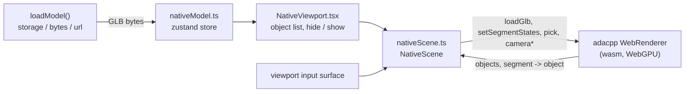
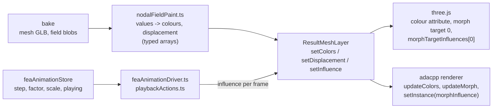
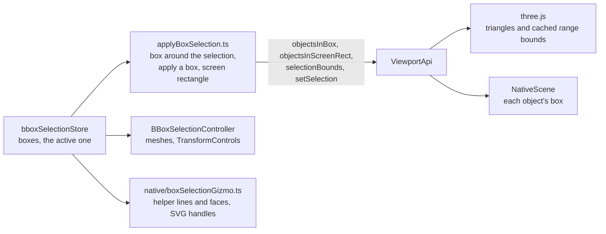
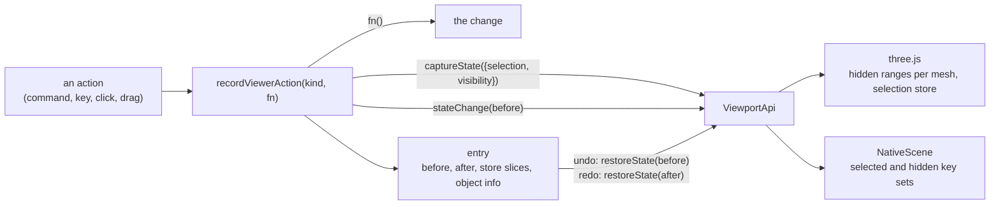

# A viewer without three.js

The browser viewer draws through one of three paths, chosen in Options > Performance > Renderer or
with `?renderer=` in the URL:

| Choice | `?renderer=` | What draws | What three.js still does |
|---|---|---|---|
| three.js (WebGL) | `three` | `THREE.WebGLRenderer` | everything |
| adacpp WebGPU | `adacpp` | adacpp's WebGPU renderer (`adacpp_render.wasm`) | scene graph, loading, controls; optionally labels, point picking and capture (see below) |
| adacpp WebGPU, no three.js | `native` | adacpp's WebGPU renderer | nothing in the viewport's own chunk |

This page is about the third. It records why it is a separate viewport, what the first slice
contains, and what each later slice has to settle. The code is `src/frontend/src/viewport/native`.

## Why it is a second viewport, not a switch

About 160 non-test modules under `src/frontend/src` import three.js, and only about two dozen of
them touch the `WebGLRenderer`. The rest use three.js as the **data model**: `CustomBatchedMesh`
holds a model's merged buffers and draw ranges, stores hold `THREE.Object3D`s and `THREE.Plane`s,
and the scene helpers add meshes, lines and sprites to one `THREE.Scene`. The adacpp WebGPU path
keeps all of that and mirrors the scene into the renderer each frame (`viewport/adacpp/sceneSync.ts`).

So there are two different questions:

- **Can the picture be made without WebGL?** Yes, with the existing data model. That is the
  `adacpp` choice with its hand-over switches: labels, point picking and capture move to adacpp one
  at a time, and "WebGPU only" constructs no `WebGLRenderer` at all (`viewport/nullRenderer.ts`).
  three.js is still loaded and still owns the scene.
- **Can the viewer run without three.js?** Only with another data model. No set of switches gets
  there, because every feature is written against `THREE.Scene`. That is what `native` explores.

## The first slice

`NativeViewport` is mounted by `CanvasWrapper` **instead of** `ThreeCanvas` and the scene
controllers. It is loaded lazily, and its chunk imports no three.js.

| Part | How the slice does it |
|---|---|
| Loading | `loadModel` resolves the source as it always does, then hands the GLB **bytes** to the store instead of calling `GLTFLoader`. `NativeScene.load` passes them to the renderer's own reader (`WebRendererApi.loadGlb`), the one the offscreen posters and the WebGPU embed use. |
| Scene model | None on the JavaScript side. The reader merges primitives per topology and material and keeps each adapy draw range as a **segment**, and `loadGlb` returns the model's objects (id, name, parent, bounds, triangle count) and which object each segment draws. |
| Several models | The scene holds any number of models. An object is known by one key made of its model's key and its id (`objectKey`), so two models may use the same ids. A load asked for as an addition joins the others, leaves the camera where it is and adds a root to the Scene tree; unloading a source removes that model's geometry (`ViewportApi.unloadSource`). |
| Per-object state | Two sets, selected and hidden, written to the renderer as segment state (`setSegmentStates`). Hidden wins over selected. |
| Camera and input | The renderer's own camera (`setCameraControlled`). The viewport maps input from the viewport's input surface (`viewport/input.ts`, the same element the three.js controls use) to semantic operations: orbit, pan, zoom, zoom towards the cursor, fit to a box, look from a direction. Fit and the named views move there over a short time, and a drag glides to a stop when the camera settings say so. |
| Picking | `WebRendererApi.pick` at the pointer, mapped through the reader's segment table to an object id. |
| Tree and object info | The viewer's own Scene tree and object info. The viewport announces the model it loaded and what a click picked (`onModelLoaded`, `onViewportPick`); the panels' side (`sceneHelpers/viewportPanelBridge.ts`) builds the tree from the GLB's scene extras and names the picked object. A tree row and a viewport object are the same thing by `ObjectRef`: the model's key and the object's id in it. |
| FEA results | Drawn through **result layers** (see below): the mesh from the bake's GLB as typed arrays, a nodal field as per-vertex colours, the deformed shape as a morph whose influence is the deformation scale. The Simulation panel, the result commands and the colour legend are the viewer's own. |
| Screenshots and the orientation gizmo | `saveScreenshot` draws the view at the screenshot's size and saves the canvas' picture. The world's axes in the corner are an SVG drawn from the camera's pose (`NativeOrientationGizmo.tsx`); an axis end looks at the model from there. |
| Failure | If WebGPU or the module cannot start, or the device is lost, the state becomes `failed` with the reason, `CanvasWrapper` mounts the three.js viewport, and the model that was handed over is loaded there. The Performance panel shows the reason. |

What the main viewer does beyond this is listed in the viewport itself under "Not available in
this mode", so nothing looks broken by omission: element (integration point) fields of an FEA
result, number labels and plugin overlays, requesting a selection box's contents from a source,
3D-mouse input and export.

React reads the selection through `viewport/api/useViewportSelection.ts` (its count, the selected
objects, a token that changes with it), so a panel written against it follows whichever viewport is
on screen.

### Keeping the chunk free of three.js

`src/__tests__/viewport/nativeViewportImports.test.ts` walks the import graph from
`NativeViewport.tsx` (static imports, re-exports and `import()`; type-only imports are erased by
the build and do not count) and fails on the first import of `three`, printing the chain that
leads to it. Shared code the chunk needs was moved out of modules that import three.js rather than
duplicated: starting the renderer lives in `viewport/adacpp/rendererModule.ts`, used by both WebGPU
viewports.

The end-to-end test `tests/full/frontend/test_render_backends.py` runs the slice in Chromium
(load, pick, select, hide, show all) and asserts that the page created no WebGL context.

## FEA results on both viewports

A shown result is three things, and only the last differs between the viewports:

| Part | Where | What it is |
|---|---|---|
| The numbers | `utils/scene/fea/nodalFieldPaint.ts` | One step of a nodal field as two typed arrays: RGB per node from the colour map and the range (the field's, the measured one, pinned ends, bands), and the un-scaled displacement per node. One pass, no allocation. |
| What a viewport draws | `viewport/api/resultLayer.ts` | `ResultMeshLayer`: colours, displacement, and the **influence** (the drawn shape is `base + influence * displacement`). `ViewportApi.results.createResultMesh` makes one from positions and indices. |
| three.js | `utils/scene/fea/threeResultLayer.ts` | The layer over a mesh: the streaming loader's result mesh is wrapped (`threeResultLayer`), so its selection, overlays and beam sections are as before. |
| adacpp renderer | `viewport/native/nativeResultLayer.ts` | One geometry with colours and a morph, one instance. Colours and displacement are written into buffers kept on the module heap, so a step allocates nothing. |
| Playing | `feaAnimationDriver.ts`, `playbackActions.ts`, `resultInfluence.ts` | The oscillator and the transport write one number per frame to the layer in `feaAnimationStore.resultLayer`. No vertex data moves while a mode shape plays. |
| Controls and legend | `utils/scene/fea/streaming/resultStores.ts` | A painted result is registered the same way from either loader: the session, the step count, the derived deformation scale, the legend's range. |
| The loader without a scene | `utils/scene/fea/streaming/layerSession.ts` | Reads the mesh GLB as typed arrays (`utils/glb/glbMesh.ts`), draws faces and element edges as layers, paints a nodal or an element field, registers the step callback. `load_fea_streaming` hands a load to it while the three.js-free viewport is on screen. |
| Element fields | `utils/scene/fea/elemFieldPaint.ts` | One step of an element (integration point) field as typed arrays: a colour per render vertex, the displacement per node, the result-point markers, the coloured lines of line elements, and each element's painted value. An element's colour is its own, so the mesh it is painted on is element-local (a vertex per triangle corner). `applyElemField.ts` writes the same output to the three.js mesh. |
| Elements as objects | `viewport/api/resultLayer.ts` (`ResultMeshObjects`), `viewport/native/resultObjects.ts` | A result mesh says which objects it is made of: a model key, its object ids, and the part of the index list each draws. The three.js-free scene makes them the renderer's segments and registers the model beside the loaded ones, so pick, select, hide, show, isolate and fit go through `ViewportApi` as for any model, and `onModelLoaded` carries the hierarchy the Scene tree lists. The selection is a per-segment colour, so the other elements keep their result colours. |
| Beam sections | `utils/scene/fea/streaming/layerBeamSolids.ts` | The beam solids of a bake as typed arrays, from the compact artefact (expanded by the compute capability) or the mesh GLB with its sidecars. Drawn as one more layer when asked for; each section is the object its element is. |
| What a layer can be | `viewport/api/resultLayer.ts` | Triangles, lines or points, with a width or diameter in pixels and an opacity: result points are a layer of points, the coloured lines of line elements and the undeformed outline are layers of lines. `streaming/layerGroup.ts` holds a result's layers as one for the controls and the playback driver. |
| Number labels | `utils/scene/fea/labelPlacement.ts`, `layout/NumberLabels.tsx` | What is worth a label and where it goes, from a `LabelSource` (elements, their vertices, where each vertex is now) and a projector. `ViewportApi.projectToScreen` projects a batch of world points to CSS pixels and depth, and `onCameraChange` says when to do it again; the three.js mesh (`numberLabels.ts`) and the layer session are the two sources. |

Both viewports paint with the same kernels. What the three.js viewport's own loader still does
that the layer session does not: recorded playback frames (a played frame is repainted from the
step cache instead; read-ahead and "load every frame" work), the feature edges of beam sections,
and the element sets of a result (the Scene tree's set rows and isolating by set act on the
three.js mesh). Plugin overlays (`plugins/sceneOverlays.ts`) are also three.js-only.

## Box selection on both viewports

A selection box is plain data, and so are its rules; only "which objects are in it" is the
viewport's to answer.

| Part | Where | What it is |
|---|---|---|
| The boxes | `state/bboxSelectionStore.ts` | Bounds, mode ("partially within", "fully within"), colour, opacity, visibility, and which box is the active one. No three.js. A change to the boxes records itself as an undo step, as a change to the section planes does. |
| The rules | `utils/bboxSelection/boxMath.ts`, `screenRect.ts`, `boxHandles.ts` | A box against a box or a triangle; a rectangle on the screen against a box's picture (a window takes what is wholly inside, a crossing what touches); a box's edges, faces and handles, and the pointer's place along a handle's axis. Plain numbers, unit-tested. |
| What a viewport answers | `viewport/api/boxSelection.ts` | `objectsInBox(box, mode)`, `objectsInScreenRect(rect, mode)` and `selectionBounds()`, all members of `ViewportApi`. The first two return an `ObjectSet`: iterable as object refs (one ref reused), and taken back by the same viewport's `setSelection` without a lookup per object. Hidden objects and ones a section plane cuts away whole are never in an answer. |
| Applying | `utils/bboxSelection/applyBoxSelection.ts` | A box around the selection, the selection a box makes, the selection a screen rectangle adds, and "the active box's selection follows its bounds and mode". Used by the commands (`Box around selection`, `Selection box takes only what is fully within`, `Reselect with selection box`, `Remove selection boxes`), the Scene panel, the tree's menu and both viewports' controllers. |
| three.js | `utils/bboxSelection/threeBoxSelection.ts`, `BBoxSelectionController.tsx` | As before the interface: an object on a box's boundary is decided on its triangles, one that straddles a screen rectangle on its vertices or triangles. Boxes are meshes, the handles spheres, the move gizmo `TransformControls`. |
| adacpp renderer | `viewport/native/nativeBoxSelection.ts`, `boxSelectionGizmo.ts` | Decided on each object's box from the GLB reader. A box's edges are helper lines and its faces see-through triangles of the renderer; the face handles and the move arrows are an SVG placed from the camera after each frame, and a press is hit-tested against them before the camera sees it. Shift and a drag draws the rectangle; a right-click on a box opens its menu. |

Where the three.js-free viewport's answer is coarser, because it keeps no triangles on the
JavaScript side:

- **Partially within a box.** An object is taken when its box touches the selection box. The
  three.js viewport looks at the triangles of an object on the boundary, so it leaves out a slanted
  or L-shaped object whose box reaches in while the object itself does not. "Fully within" is the
  same on both: an object is inside exactly when its box is.
- **A rectangle on the screen.** A window takes an object when the picture of its box is wholly
  inside, so it can miss a slanted object that is itself inside while its box's corner sticks out;
  a crossing takes an object when the picture of its box touches, so it can take one that only its
  box's corner reaches.
- **An object with children that draws something itself.** The reader reports one box per object,
  of the object and everything below it, so such an object is judged by the larger box.

The boxes are kept across reloads on both viewports:

- **Kept across reloads.** `utils/bboxSelection/boxPersistence.ts` keeps the boxes of a scope in the
  browser, bound by whichever viewport draws them. A box is in world coordinates, and the two
  viewports place a model differently: the three.js one recentres what it loads, the three.js-free
  one draws a model where its file puts it. The offset in use is published as plain numbers
  (`state/sceneFrameStore.ts`: mirrored from the three.js model state, zero on the three.js-free
  viewport) and stored with the boxes, so a box moves by the difference and stays over the same
  object, on a reload and from one viewport to the other.
Not on the three.js-free viewport yet: "Request from source" in a box's menu (what it loads comes
through the three.js scene's loaders; the menu says so).

## Undo and redo on both viewports

One history (`state/viewerHistoryStore.ts`), filled by `recordViewerAction` in
`utils/scene/viewerHistory.ts`, which imports no three.js. What is selected and what is hidden is
the viewport's own, so the history asks the viewport on screen:

| Part | Where | What it is |
|---|---|---|
| The interface | `viewport/api/viewportState.ts` | `captureState(what)` notes the state before an action, `stateChange(before)` says what the action changed (and gives the state after it on request), `restoreState(state)` goes to one end of a step. A state is opaque outside the viewport that made it. An action that cannot hide or show anything asks for the selection only, and the viewport then does not look at what is hidden. |
| The history | `utils/scene/viewerHistory.ts` | One entry per user action: the two ends of the viewport's step, the store slices it was given (section planes, selection boxes, FEA isolation) and the object info's name. Nested actions are one entry, actions with the same coalesce key in quick succession (a drag) are one entry, and nothing records while an entry is applied. The section and box stores record through it directly. |
| three.js | `utils/scene/threeViewportState.ts` | As before the interface: the hidden ranges per mesh are copied before an action that can hide, and the entry keeps the difference per model by its scene name; the selection is kept as element ids per model. Entries survive a model being removed and loaded again. |
| adacpp renderer | `viewport/native/nativeViewportHistory.ts` | The selected keys as a copy, and the keys a step hid and showed. `setSelection`, `clearSelection`, `hide`, `show`, `isolate`, `showAll`, `hideSelected`, `hideOthers` and a click in the view are each one step. A key names a model and an object in it; keys of a model no longer on screen are skipped. |
| Keys and commands | `viewport/api/viewportShortcuts.ts`, `layout/coreCommands.ts` | Undo and Redo (Ctrl+Z, Ctrl+Y, Ctrl+Shift+Z) are bound by each viewport to the same history. |

Where the three.js-free viewport differs: it has no entries for models loaded and removed
(`utils/scene/modelHistory.ts` reloads through the three.js loaders), so a model that replaces the
scene starts the history over, and a model that joins or leaves keeps it.

## What the next slices have to settle

These are open design points, ordered by how much of the viewer depends on them.

1. **The interface features program against.** A feature that reaches into `THREE.Scene` exists on
   one viewport only. `src/frontend/src/viewport/api` is the interface both stand behind:
   `ViewportApi` (the selection as object refs and its changes, hiding, showing and isolating
   objects, how each is drawn, the model's box, what a box or a screen rectangle takes, its undoable state, fit, named views, reset, orbit and pan by step), implemented by `threeViewport.ts` over the three.js scene and by
   `native/nativeViewportApi.ts` over `NativeScene`. The viewport on screen registers itself
   (`setActiveViewport`); commands ask `activeViewport()`, and the keys are bound once for both in
   `viewportShortcuts.ts`. A viewport says what it cannot do yet (`unavailable(feature)`), and the
   command is offered disabled with that reason. The interface grows one feature area at a time:
   still to come are objects by id with their state (colour, transparency), their bounds, and
   overlay geometry (lines, points) by handle. An area not on it yet still goes straight to
   three.js and is absent on the three.js-free viewport.
2. **Where per-object state lives.** `CustomBatchedMesh` owns hidden and selected ranges, and a
   number of scene objects update themselves in `onBeforeRender`, which `SceneSync` replays every
   frame. Without three.js there is no such hook: state has to live in stores keyed by object id,
   and whatever follows the camera or the animation has to be driven from the frame loop.
3. **The model beyond geometry.** `GLTFLoader` also gives the main viewer the node hierarchy, the
   `ADA_EXT_data` extension (design / simulation objects, FEA metadata) and animations. The native
   path gets the hierarchy from the reader, which also hands back the extension data as JSON text;
   nothing reads it yet. A streamed FEA result does not come through the reader at all: its mesh is
   read as typed arrays and drawn through result layers (above), which name the elements as the
   mesh's objects, so they are picked, selected and hidden like a loaded model's.
4. **Section planes and caps.** The planes are plain data in `state/sectionStore` (no three.js),
   and both viewports cut by them, so the section commands and the panel's sliders work on either.
   On the three.js-free viewport the reader flags single-sided surfaces as closed solids, so their
   cut is filled, and `native/sectionGizmo.ts` draws the active plane's outline and an arrow that
   drags it (helper lines on top, hit-tested on screen).
5. **Labels and markers.** Both viewports draw them from plain data. A feature asks the viewport
   on screen for a layer of billboards (`ViewportApi.billboards(name)`, `viewport/api/billboards.ts`)
   and adds camera-facing images to it by handle: a world position, an image painted on a plain
   canvas, and a height in world units or in pixels. The three.js viewport draws each as a
   `THREE.Sprite` (`threeBillboards.ts`), the three.js-free one as a sprite of the renderer with the
   canvas' pixels as its texture (`native/nativeBillboards.ts`); a load empties the renderer's scene,
   so that layer keeps the pixels and makes its sprites again. Where an object is comes from the
   viewport too (`objectsCentre`), as does a change of selection (`onSelectionChange`). The type
   icons of a procedural model and the names of the selected objects ("Object names") are drawn
   this way, by controllers that follow the viewport on screen (`followActiveViewport`). The number labels
   of an FEA result are HTML placed through the viewport (`projectToScreen`, `onCameraChange`), on
   either one. Still the three.js viewport's only: a plugin's labels (`addLabels`), which can pin
   to FEA elements and are cut by section planes at their anchor.
6. **Controls parity.** The renderer's camera covers orbit, pan, zoom, zoom towards the cursor, fit
   to the model or the selection, named views and the user's input mapping. Still the main
   viewer's only: the orientation gizmo, orthographic projection as a setting, and 3D-mouse input.
7. **Uses of three.js outside the main viewport.** The equipment preview, the cell builder, the
   robot (STL) loader, the FEA GLB assembly (`GLTFLoader` / `GLTFExporter` used to build data, not
   to draw) and the three.js embed each need a decision of their own: ported, exempt, or dropped.

The slice is there to make these concrete on real models before any of them is decided.
