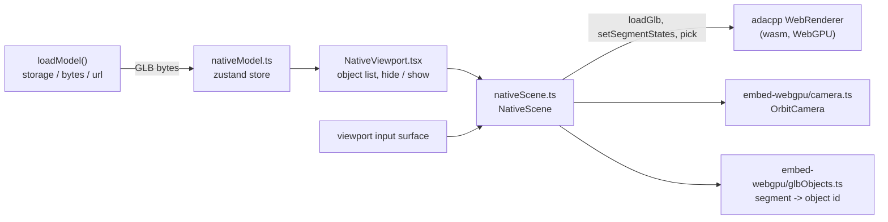

# A viewer without three.js

The browser viewer draws through one of three paths, chosen in Options > Performance > Renderer or
with `?renderer=` in the URL:

| Choice | `?renderer=` | What draws | What three.js still does |
|---|---|---|---|
| three.js (WebGL) | `three` | `THREE.WebGLRenderer` | everything |
| adacpp WebGPU | `adacpp` | adacpp's WebGPU renderer (`adacpp_render.wasm`) | scene graph, loading, controls; optionally labels, point picking and capture (see below) |
| adacpp WebGPU, no three.js | `native` | adacpp's WebGPU renderer | nothing in the viewport's own chunk |

This page is about the third. It records why it is a separate viewport, what the first slice
contains, and what each later slice has to settle. The code is `src/frontend/src/viewport/native`.

## Why it is a second viewport, not a switch

About 160 non-test modules under `src/frontend/src` import three.js, and only about two dozen of
them touch the `WebGLRenderer`. The rest use three.js as the **data model**: `CustomBatchedMesh`
holds a model's merged buffers and draw ranges, stores hold `THREE.Object3D`s and `THREE.Plane`s,
and the scene helpers add meshes, lines and sprites to one `THREE.Scene`. The adacpp WebGPU path
keeps all of that and mirrors the scene into the renderer each frame (`viewport/adacpp/sceneSync.ts`).

So there are two different questions:

- **Can the picture be made without WebGL?** Yes, with the existing data model. That is the
  `adacpp` choice with its hand-over switches: labels, point picking and capture move to adacpp one
  at a time, and "WebGPU only" constructs no `WebGLRenderer` at all (`viewport/nullRenderer.ts`).
  three.js is still loaded and still owns the scene.
- **Can the viewer run without three.js?** Only with another data model. No set of switches gets
  there, because every feature is written against `THREE.Scene`. That is what `native` explores.

## The first slice

`NativeViewport` is mounted by `CanvasWrapper` **instead of** `ThreeCanvas` and the scene
controllers. It is loaded lazily, and its chunk imports no three.js.

| Part | How the slice does it |
|---|---|
| Loading | `loadModel` resolves the source as it always does, then hands the GLB **bytes** to the store instead of calling `GLTFLoader`. `NativeScene.load` passes them to the renderer's own reader (`WebRendererApi.loadGlb`), the one the offscreen posters and the WebGPU embed use. |
| Scene model | None on the JavaScript side. The reader merges primitives per topology and material and keeps each adapy draw range as a **segment**. `glbObjects.ts` replays that batching on the GLB's JSON to name every segment (`matchGeometries` drops a geometry whose replay disagrees with what the reader built, so a mismatch shows as "no object", never as a wrong one). |
| Per-object state | Two sets, selected and hidden, written to the renderer as segment state (`setSegmentStates`). Hidden wins over selected. |
| Camera and input | `OrbitCamera` from the embed (z up, orbit / pan / zoom), bound to the viewport's input surface (`viewport/input.ts`), the same element the three.js controls use. |
| Picking | `WebRendererApi.pick` at the pointer, mapped through the segment names to an object id. |
| Object list | The object ids with their path of names from the GLB's hierarchy; click selects, each row hides or shows. |
| Failure | If WebGPU or the module cannot start, or the device is lost, the state becomes `failed` with the reason, `CanvasWrapper` mounts the three.js viewport, and the model that was handed over is loaded there. The Performance panel shows the reason. |

What the main viewer does beyond this is listed in the viewport itself under "Not available in
this mode", so nothing looks broken by omission: section planes, FEA results and animation, labels
and plugin overlays, measurements and gizmos, screenshots and export, overlaying several models,
and the main viewer's tree, info and scene panels.

### Keeping the chunk free of three.js

`src/__tests__/viewport/nativeViewportImports.test.ts` walks the import graph from
`NativeViewport.tsx` (static imports, re-exports and `import()`; type-only imports are erased by
the build and do not count) and fails on the first import of `three`, printing the chain that
leads to it. Shared code the chunk needs was moved out of modules that import three.js rather than
duplicated: starting the renderer lives in `viewport/adacpp/rendererModule.ts`, used by both WebGPU
viewports.

The end-to-end test `tests/full/frontend/test_render_backends.py` runs the slice in Chromium
(load, pick, select, hide, show all) and asserts that the page created no WebGL context.

## What the next slices have to settle

These are open design points, ordered by how much of the viewer depends on them.

1. **The interface features program against.** Today a feature reaches into `THREE.Scene`. A
   three.js-free viewer needs a narrow scene interface instead: objects by id, their state
   (hidden, selected, colour, transparency), their bounds, and a way to add overlay geometry
   (lines, points, markers) by handle. `NativeScene` is the start of it; the three.js viewport
   would implement the same interface so that panels and commands work on either. Until that
   exists, each feature ported to the native viewport is a second implementation.
2. **Where per-object state lives.** `CustomBatchedMesh` owns hidden and selected ranges, and a
   number of scene objects update themselves in `onBeforeRender`, which `SceneSync` replays every
   frame. Without three.js there is no such hook: state has to live in stores keyed by object id,
   and whatever follows the camera or the animation has to be driven from the frame loop.
3. **The model beyond geometry.** `GLTFLoader` also gives the main viewer the node hierarchy, the
   `ADA_EXT_data` extension (design / simulation objects, FEA metadata) and animations. The native
   path reads the hierarchy from the GLB's JSON. The extension data and the streaming FEA loader
   (`utils/scene/fea`) are not connected to it.
4. **Section planes and caps.** The renderer has `setClipPlanes` and `setSectionCaps`; what is
   missing is the plane store wired to them and a gizmo. A gizmo without `TransformControls` is its
   own piece of work (handles as on-top instances, hit-testing through `pick`).
5. **Labels and markers.** The renderer draws textured sprites. A native label layer needs the
   text rasterised to textures without a `THREE.CanvasTexture` (a plain canvas works) and a store of
   label positions.
6. **Controls parity.** The main viewer offers two camera controllers, named views, fit to
   selection, the orientation gizmo and 3D-mouse input. `OrbitCamera` covers orbit, pan, zoom and
   fit to the model.
7. **Uses of three.js outside the main viewport.** The equipment preview, the cell builder, the
   robot (STL) loader, the FEA GLB assembly (`GLTFLoader` / `GLTFExporter` used to build data, not
   to draw) and the three.js embed each need a decision of their own: ported, exempt, or dropped.

The slice is there to make these concrete on real models before any of them is decided.
